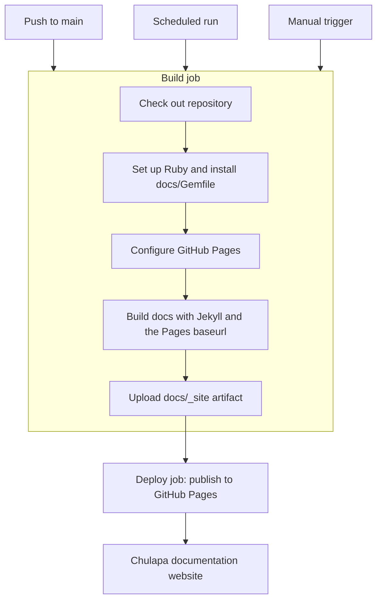
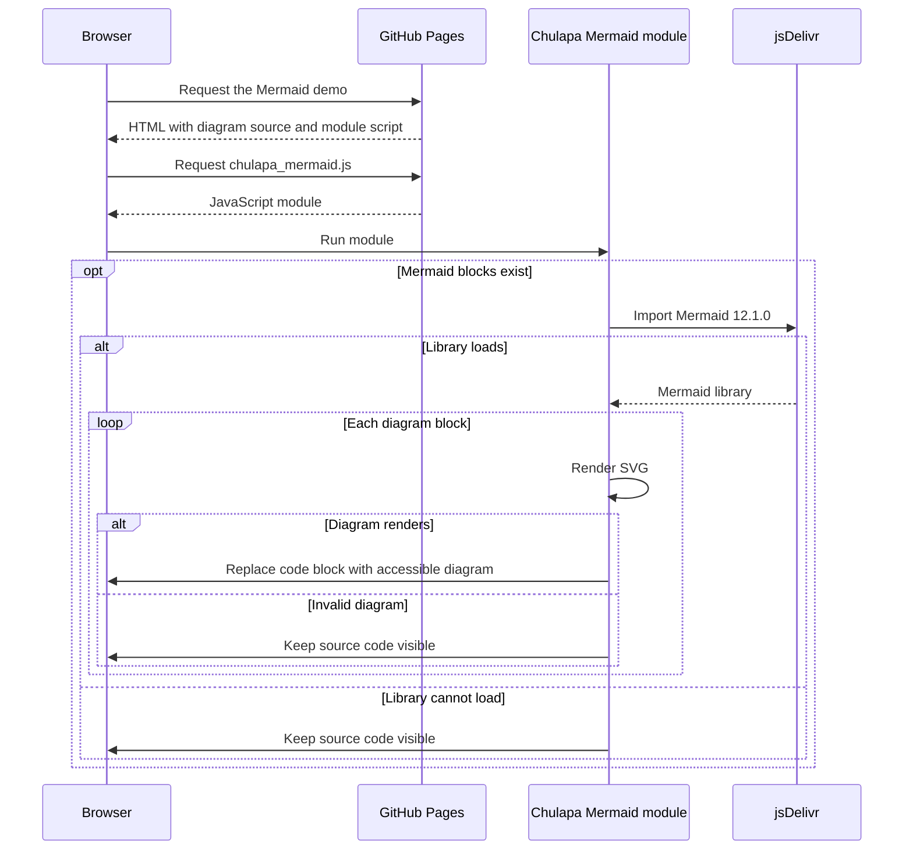

Mermaid support is available in the v2.2.0.
Follow [Add a Mermaid diagram](../docs/33-add-diagram) to enable diagrams on your
page. See the [Mermaid reference](../docs/04-layouts#mermaid-diagrams) for browser
requirements, security restrictions and fallback behavior. The diagrams below
show a publishing workflow and how rendering works in the browser.

## Publishing the documentation

A push to `main` starts this repository's GitHub Pages workflow. It installs
Ruby dependencies from `docs/Gemfile`, builds the documentation with Jekyll,
uploads the generated site and deploys it to Pages. The workflow can also run
on its schedule or be started manually.

## Rendering Mermaid in a Chulapa page

The browser loads Mermaid from jsDelivr and replaces valid diagram blocks with
diagrams. If loading or rendering fails, the source stays visible.

