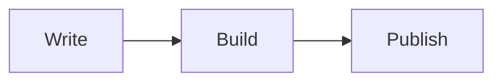

This annotated example shows home-page source and sample content from
[technical-blog](https://github.com/dieghernan/chulapa/tree/main/examples/technical-blog).
It runs inside the documentation site, using this site's skin and configuration;
it is not the standalone example's home page. The full folder includes its own
`Gemfile` and `_config.yml`, with no publishing workflow.

For preparation, preview and publication, follow
[Run and publish a starter example](../docs/09-run-starter).

Mermaid requires v2.2.0 or later; it is absent from v2.1.0.

## Home-page header

```yaml
---
layout: indexcategory
title: Engineering notes
subtitle: Code examples, diagrams and practical tutorials
header_type: base
include_collection: posts
index_sort: date
index_items: 12
---
```

## Home-page content

Notes with code, diagrams and mathematical notation.

## Sample article

Source: [`2026-01-01-first-post.md`](https://github.com/dieghernan/chulapa/blob/main/examples/technical-blog/_posts/2026-01-01-first-post.md).
Its settings enable the features illustrated below:

```yaml
---
title: Document a workflow
layout: default
header_type: post
show_date: true
show_toc: true
mermaid: true
mathjax: true
include_on_feed: true
---
```

Describe a workflow with a diagram, an equation and a code example.

## Workflow

The process starts with writing and ends with publishing.



## Code

```js
const steps = ["Write", "Build", "Publish"];
console.log(steps.join(" -> "));
```

## Equation

$$a^2 + b^2 = c^2$$

## Site configuration

```yaml
# Edit title, description, repository, url and baseurl before publishing.
remote_theme: dieghernan/chulapa
# The default branch includes development features. Append @TAG to pin a release.
title: Engineering notes
description: Code examples, diagrams and practical tutorials
repository: username/site
url: https://username.github.io
baseurl: /site
locale: en-US
plugins:
  - jekyll-remote-theme
  - jekyll-include-cache
  - jekyll-github-metadata
  - jekyll-paginate
  - jekyll-sitemap
exclude: [Gemfile, Gemfile.lock, README.md, vendor]
kramdown:
  input: GFM
chulapa-skin:
  skin: gitdev
navbar:
  brand:
    title: Engineering notes
  nav:
    - title: Home
      url: /
defaults:
  - scope:
      path: ""
      type: posts
    values:
      layout: default
      header_type: post
      include_on_feed: true
      show_date: true
```
