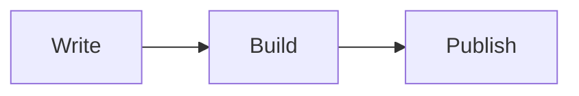

Use this page to look up a layout, snippet or page setting. For everyday editing,
use [Create a post](./15-create-post), [Create a page](./16-create-page) or
[Add an image](./17-add-image). A **layout** is a page design; **front matter** is
the settings block between `---` lines at the top of a content file.

Moving existing posts or pages? Use the
[migration front matter mapping](./46-migration-fields#layouts-and-page-front-matter).

Browse [layouts](#a-layouts), [page options](#options), [snippets](#b-snippets),
[page SEO](#seo-metadata) or [advanced customization](#advanced-customization-reference).

## Choose a layout or an optional feature

Use `default` for articles and ordinary pages, [Minimal](#minimal) for
custom content or [Landing page](#landing-page) for an introduction. Check
the version beside each feature if you use a pinned release or a gem.

## A. Layouts

### General purpose

#### Default

Set `layout: default` in page front matter or [site defaults](#a-note-on-defaults).

##### Options

Additional options you can set on the front matter or via defaults:

Jekyll also accepts these settings in the same front matter block:

| Setting | Use |
| --- | --- |
| `layout` | Choose a layout from this guide. |
| `permalink` | Set a page's address, such as `/contact/`. |
| `published` | Set `false` to omit a page or post from the normal build; this does not protect private files. |
| `slug` | Set the slug used by a post's address pattern. |
| `categories`, `tags` | Group articles and provide the labels used by badges and related cards. |
| `excerpt_separator` | Override the site's post excerpt boundary. |
| `sitemap` | Set `false` to exclude the page from `jekyll-sitemap`. |
| `locale` | Override the site language for this page. |

Component switches such as `show_date`, `show_author`, `show_toc`,
`show_comments` and `show_breadcrumb` are off when unset, unless your site's
`defaults` enables them. `show_header` is a separate opt-in for `minimal`;
see [Optional header](#optional-header).

- `title`, `subtitle`: Visible heading and subtitle for supported header types;
  also used when generating metadata.
- `date`, `last_modified_at`: Date of the page and last modification date. See [here](https://jekyllrb.com/docs/variables/#page-variables) to learn the accepted format of dates.
- `excerpt`: A summary of the content. For posts, Jekyll generates an excerpt
  using its [post excerpt settings](https://jekyllrb.com/docs/posts/#post-excerpts).
  For metadata when no excerpt is available, see [description fallbacks](#seo-metadata).
- `description`: Explicit metadata description, independent of the visible subtitle and excerpt. See [SEO metadata](#seo-metadata) for precedence.
- `mathjax`: Set to `true` to load MathJax for mathematical notation.
- `mermaid`: Set to `true` to render Mermaid diagrams. Disabled by default; see
  [Mermaid diagrams](#mermaid-diagrams).
- `og_image`: Open Graph image displayed on the web and social networks when
  sharing the page. This field does not insert an image into the page body.
- `schema_image`: A representative image URL or list of image URLs for a post's
  `BlogPosting` JSON-LD. It overrides the article image without changing Open
  Graph, Twitter cards or the visible header. See [Article
  images](#article-images).
- `robots`: Search engine instructions, such as `"noindex, follow"`. This does
  not make a page private; see [Search crawler directives](#search-crawler-directives).

- `header_type`: Choose `base`, `post`, `hero`, `image` or `splash`. Leave it
  unset or use an unrecognized value for no header.
- `header_img`: Image to be displayed on the header. If `og_image` is not set,
  it also supplies the sharing image before site-level fallbacks.

**Image previews** depend on each social platform's requirements. Use an
accessible image URL and check the resulting preview. You can use a
high-resolution image for `header_img` and a smaller sharing image for
`og_image`.
{: .alert .alert-info .p-3 .mx-2 .mb-3}

- `project_links`: Add header navigation links styled as buttons, for example
  links to a project's source code or documentation. Each entry accepts `url`,
  `icon` and `label`. Example:

```yaml
---
title: External project
project_links:
    - url: https://github.com/XXX # url1
      icon: fab fa-github         # Font Awesome icon code1
      label: View on GitHub       # Label on button 1
    - url: https://colab.research.google.com/XXX #url2
      icon: fab fa-python   # Font Awesome icon code2
      label: Open in Colab  # Label on button 2
---
```
- `show_date`: Display the publication date and the last modified date,
  if provided.
- `show_sociallinks`: Display sharing links for Facebook, Twitter/X, WhatsApp
  and LinkedIn.
- `show_author`: Set it to `true` to display the page author. It uses the site
  [author settings](https://dieghernan.github.io/chulapa/docs/02-config) unless
  the page supplies its own author mapping:

  For a guest author, set their own profile URL; it does not inherit the site
  author's URL.

  In v2.2.1 development, Chulapa-authored skins place the author's location
  and links below the name on narrow screens.

  In v2.2.1 development, `show_author: false` hides the visible card while
  retaining invisible Microformats2 author data in `default`, derived layouts
  and `landingpage`. Archive, category, tag and card listings identify each
  entry's own author, including guests. These data do not add visible content
  or keyboard stops. Author profile URLs use `author.url`, then the first
  HTTP(S) link belonging to that author; without either, only available author
  details are included.

```yaml
---
title: "Plain post 2"
subtitle: "Example 2"
author:
  name: Another name
  url: /about/another-author/
  location: Santiago de Compostela
  avatar: https://github.com/devdieghernan.png
  links:
    - url: https://twitter.com/jack2
      icon: "fab fa-twitter"
      label: "Twitter"
---
```

- `show_toc`: Displays a table of contents using [jekyll-toc](https://github.com/allejo/jekyll-toc).
  Headings with the `no_toc` class are excluded, as they are from kramdown
  content indexes.

- `show_sidetoc`: Puts the table of contents in a panel opened by a button
  on the left. Only headings with IDs appear. Markdown headings get IDs
  automatically; add an `id` to each HTML heading you want to include.
  For an index inside the article body, see
  [Add a table of contents inside an article](./58-content-toc).

Since v2.2.0, the in-page, sidebar and kramdown TOCs highlight the current
visible section with JavaScript, while preserving the sidebar's Tab order.
Their links also work without JavaScript.

- `h_min` and `h_max`: Minimum and maximum heading level to be included in the
  table of contents. **min: 2, max: 4**.

- `show_related`: Shows up to three other collection documents. A candidate
  needs two shared tags in the same collection or three across collections.
  More matches rank first, then newer dates.
- `show_random`: Picks up to three documents from the same pool at build time.
  In v2.2.0, a single match renders on its own and both components respect
  each candidate's `show_date: false`.

- `related_label` and `random_label`: Text or HTML displayed before the related
  and random cards, respectively. Custom HTML is rendered as supplied. Use
  headings that fit the page hierarchy, such as `<h2 class="h5">Related
  posts</h2>` for a separate section. The `h5` class controls its visual size
  without skipping heading levels.

- `show_bottomnavs`: Display previous and next navigation at the bottom of the
  page when Jekyll supplies `page.previous` and `page.next`. This does not
  create navigation between arbitrary standalone pages.

- `show_categories` and `show_tags` display badges at the bottom with the
  `categories` and `tags` set for the page. These badges could be set as links
  to a cloud index, with the destination URL defined by `cloudtag_url` and
  `cloudcategory_url`. See [Cloud tags](#cloud-tags-and-categories) layouts.
- `include_on_search`: Set to `false` to omit a page from the local search
  indexes. See [Search visibility](./65-search-visibility) for Algolia,
  external crawlers and sitemaps.
- `include_on_feed`: Set the YAML boolean `true` on a dated post or collection
  document to include it in [the built-in feeds](./56-publish-feeds).
  Use the [jekyll-feed guide](./57-jekyll-feed) to preserve a subscription URL.

- `show_comments`: Display the comment widget when a supported
  `comments.provider` is configured.
- `show_breadcrumb`: Shows breadcrumb navigation on a page. Use with
  `breadcrumb_list`.
- `breadcrumb_list`: A list with breadcrumbs. It is a good practice to set this
  on your defaults.

```yaml
---
title: "Plain post 3"
show_breadcrumb: true
breadcrumb_list:
  - label: Home
    url: /
  - label: Demo
    url: /demo
---
```

See an example [here](https://dieghernan.github.io/chulapa/demo/archive).

Even if you don't want to show the breadcrumb, you can still specify the paths. The theme generates breadcrumb JSON-LD independently of `show_breadcrumb`. Without a list, non-home pages use a home/current-page breadcrumb. Structured data does not guarantee rich results. More information [here](https://developers.google.com/search/docs/appearance/structured-data/breadcrumb) and test tool [here](https://search.google.com/test/rich-results).
{: .alert .alert-info .p-3 .mx-2 .mb-3}

#### Make a post citable

Available in v2.2.1 development. Add `citation: true` to the front matter of
a post using the default layout. At the end of the article, look for
**How to cite this post**. It shows a simplified APA reference in English
and a **BibTeX** disclosure you can open and copy. Set `citation: false` to
disable the block, including when it was enabled through front matter defaults.

See the citation at the end of the
[Ask <span class="chulapa">Chulapa</span> post]({{ '/blog/20261009_building-a-documentation-chatbot' | relative_url }}#chulapa-citation-label).
Open **BibTeX** to view and copy the entry.

To give the citation its own metadata, replace `citation: true` with a map.
For example, add this to the front matter of a post about a journal article:

```yaml
title: Better hillshading with R
author:
  name: Diego Hernangómez
citation:
  type: article-journal
  id: hillshade-2022
  author:
    - name:
        given: Ana María
        family: García López
    - name:
        literal: Terrain Research Group
  issued: "2022-03"
  container-title: Terrain Studies
  volume: 4
  issue: 2
  page: "15–21"
  doi: "10.1234/hills"
  url: https://example.org/articles/hills/
```

The citation shows `García López, A. M.`, and BibTeX exports
`García López, Ana María`. Both include the group author. The post's byline
continues to use the top-level `author`. A plain name string or a list of
strings also works. Plain names appear as entered.

| Field under `citation` | Behavior and default |
| --- | --- |
| `type` | The visible reference defaults to `post-weblog` for Jekyll posts and `webpage` for other pages. Set `webpage` explicitly to cite a post as a standalone page. Web types and unrecognized types use `@misc` in BibTeX. `article-journal` uses `@article`. |
| `author` | Falls back to the post author and then the site author. With no author, the visible reference starts with the title and BibTeX omits `author`. |
| `title` | Falls back to the post title. |
| `issued` | Falls back to the post date. Use a quoted year, year and month, or full date, such as `"2022-03"`. The visible reference uses `n.d.` if the date is unavailable. BibTeX exports the year and month when available. |
| `id` | BibTeX key. Omit it to use the post date and slug, for example `post20261111-hillshading`. Without a date, the key starts with `post-`. Use an explicit key if two entries would otherwise share a key. |
| `url` | Absolute HTTP(S) URL of the cited work. Falls back to the page's canonical URL. |
| `doi` | DOI of the cited work, for example `10.1234/hills`. Set it under `citation` when migrating from a Quarto document that sets a top-level `doi`. The visible reference prefers the DOI link. BibTeX can carry both the DOI and the URL. |
| `container-title` | Site or publication name. For a web entry it falls back to the site title. For a journal article it is omitted when missing. |
| `volume`, `issue`, `page` | Optional journal details. BibTeX exports the issue as `number` and the page range as `pages`. |

The visible reference italicizes the blog name for `post-weblog`, the page
title for `webpage`, and the journal name and volume for `article-journal`.
See the official [APA blog post examples](https://apastyle.apa.org/style-grammar-guidelines/references/examples/blog-post-references)
and [APA webpage examples](https://apastyle.apa.org/style-grammar-guidelines/references/examples/webpage-website-references).
[One World's Corona timelapse post](https://dieghernan.github.io/202203_Corona-timelapse/)
shows the blog format in use.

To enable citations and set the type explicitly for every post, add this
entry to the existing `defaults` list in `_config.yml`:

```yaml
defaults:
  - scope:
      path: ""
      type: posts
    values:
      citation:
        type: post-weblog
```

##### Move citation metadata from Quarto

Copy the supported fields from the [Quarto citation map](https://quarto.org/docs/reference/metadata/citation.html).
Use `author.name` for the post byline and `citation.author` for the full
bibliographic author list. Set `citation.page` for the APA and BibTeX page
range. The Google Scholar fields below also accept explicit page endpoints.
Without `citation.url`, the theme uses the Jekyll canonical URL.

The reference uses simplified English APA and BibTeX with separate year and
month fields. The theme strips formatting from titles and publication names.

##### Add Google Scholar metadata

Add `google-scholar: true` at the top level of the front matter of a citable
post using `layout: default`. Keep `citation: true` or your existing citation map.

Use this switch when the post presents the work itself. For a post discussing a
work published elsewhere, you can offer a copyable citation on its own.

```yaml
layout: default
citation: true
google-scholar: true
```

Use the following fields from
[Quarto's citation metadata](https://quarto.org/docs/authoring/create-citeable-articles.html#citation-fields).
The theme omits empty values.

| Field under `citation` | HTML tag | Value or fallback |
| --- | --- | --- |
| `title` | `citation_title` | Title of the work, with the post title as the fallback. |
| `author` | `citation_author` | One tag per author with their full name. Falls back to the post author and then the site author. |
| `issued` | `citation_publication_date` | Publication date, with the post date as the fallback. Google Scholar receives `YYYY/MM/DD` for a complete date or `YYYY` otherwise. |
| `url` | `citation_fulltext_html_url` | Absolute URL of the full-text HTML, with the canonical URL as the fallback. The visible reference may still link to the DOI. |
| `container-title` | `citation_journal_title` | Journal name for `article-journal`. |
| `volume`, `issue` | `citation_volume`, `citation_issue` | Volume and issue for `article-journal`. |
| `page` | `citation_firstpage`, `citation_lastpage` | Page or page range for `article-journal`. For a single page the theme emits only the first-page tag. |
| `doi` | `citation_doi` | DOI for `article-journal`. |
| `pdf-url` | `citation_pdf_url` | Absolute URL of the full-text PDF. For Google Scholar, place the PDF in the same subdirectory as the HTML abstract. |
| `available-date` | `citation_online_date` | Online publication date. Enter a quoted date in the format you want to publish, such as `"2022/03/15"`. The theme passes it through as entered. |
| `abstract`, `abstract-url` | `citation_abstract`, `citation_abstract_html_url` | Plain-text abstract and its HTML URL. |
| `keyword`, `language` | `citation_keywords`, `citation_language` | Comma-separated keywords and the language code of the cited work. |
| `isbn`, `issn`, `eissn`, `pmid` | `citation_isbn`, `citation_issn`, `citation_eissn`, `citation_pmid` | Identifiers. Quote these values to preserve leading zeros. |
| `container-title-short`, `collection-title` | `citation_journal_abbrev`, `citation_series_title` | Abbreviated journal name and series title. |
| `page-first`, `page-last` | `citation_firstpage`, `citation_lastpage` | Explicit endpoints for `article-journal`. Each overrides the corresponding endpoint from `page` in the HTML tags. |

Google Scholar requires a title, the first author's full name and a publication
year. For work hosted on your site, use its full-text HTML URL and follow the
[Google Scholar inclusion guidelines](https://scholar.google.com/intl/en/scholar/inclusion.html).

### Landing page

This is a version of the `default` layout that uses a dedicated background and
text color. The background defaults to `hero-chulapa-bg-color`, which defaults
to the navbar background color. Set `landingpage-chulapa-bg-color` and
`landingpage-chulapa-text-color` through `chulapa-skin.vars` to customize it.
```yaml
---
layout: landingpage
---
```

The options are the same as those for the [`default`](#default) layout.

#### Minimal

The `minimal` layout includes the navbar, footer and an optional header.
Shared metadata options such as `description`, `seo_title`, `og_title`,
`canonical_url` and `locale` remain available, along with:
`title`, `subtitle`, `date`, `last_modified_at`, `excerpt`, `mathjax`, `mermaid`,
`og_image`,
`schema_image` (for posts), `robots`, `author`, `include_on_search`,
`include_on_feed` and `show_comments`. Content is rendered directly between
the navbar and footer; author panels and tables of contents are not
added automatically.

Unlike `default` and `landingpage`, `minimal` does not automatically declare a
Microformats2 `h-entry`. Custom content can provide its own `h-entry` wrapper,
with `p-name`, `u-url` and `e-content` properties, without including the navbar
or footer in the entry. This behavior is available in v2.2.0.
{: .alert .alert-info .p-3 .mx-2 .mb-3}

In development for v2.2.1, `default` and layouts derived from it expose a hidden
representative image as `u-photo u-featured` inside the page's `h-entry`.
The image uses page `og_image`, page `header_img`, then site `og_image`;
it is omitted when none is available. Avatars are not used as a fallback.
Set `og_image_alt` in the page's front matter to describe its image. Site
`og_image_alt` is inherited only for the site image when neither page image
is set; otherwise the page title is the fallback text. The image does not
change the visible layout and is excluded from the outer `h-feed` of list
layouts. `landingpage` and `minimal` do not add this image automatically.
Consumers such as Bridgy Fed can use this metadata, but their
publication behavior depends on the service and discovery method.

```yaml
---
layout: minimal
---
```

##### Optional header

Minimal pages remain headerless by default, even when `header_type` is set through global defaults. To reuse a theme header while keeping the content area unrestricted, set the Boolean `show_header: true`:

```yaml
---
layout: minimal
title: My wide page
subtitle: Custom content with a theme header
show_header: true
header_type: hero
header_img: /assets/img/banner.jpg
---
```

Use the existing header types (`base`, `post`, `hero`, `image` or `splash`) and `project_links` options. A missing or unsupported `header_type`, including `none`, produces no header. Set `show_header: false` to disable the optional header on a minimal page, including when overriding front matter defaults. The option does not add a content container; your HTML controls the width and spacing. See the [minimal header demo]({{ '/demo/minimal-header' | absolute_url }}).

`show_header` controls the optional header in `minimal` and custom layouts that inherit from it. The existing headers in `default` and `landingpage` retain their behavior and render only once. To hide those headers, keep using `header_type: none`.

If a custom layout already includes its own header, add `header_in_content: true` to that layout's front matter before enabling `show_header`. This prevents the parent `minimal` layout from adding another header. Custom layouts without an existing header can use `show_header: true` directly.

### Specific purpose

All these layouts are meant to be used for specific purposes rather than for
overall content. These layouts are linked to the `default` layout, so all the
options described above also apply.

#### Archive

This layout creates a chronological archive of your content. See an example [here](https://dieghernan.github.io/chulapa/demo/archive). Currently you can include any collection (including `_posts`) or select some. This allows you to have specific archives by collection and an overall archive for all your content.

Options available:
- `include_collection`: Collection name or comma-separated collection names,
  such as `posts,demo`. Use names without leading underscores and omit spaces
  around commas. If unset, **documents from all collections are included**.
  Standalone pages are not included.
- `include_missdates`: Set it to `true` if you want to include also those pages
  without a date.

```yaml
---
layout: archive
---
```

#### Cloud tags and categories

There are two layouts you can use to create clouds of tags and categories:

```yaml
---
layout: cloudtag
---
```

For a category cloud, use:

```yaml
---
layout: cloudcategory
---
```

Setup: [Add tag and category indexes](./63-tag-category-clouds). The index
page selects collections; `cloudtag_url` and `cloudcategory_url` on documents
or their defaults connect the article badges to that page. `show_tags` and
`show_categories` control badge display. A matching permalink is required.

Use `cloudtag` and `cloudcategory` with Jekyll 3 or 4. The old `cloudtag2` and
`cloudcategory2` layouts are compatibility aliases; no `grouptag.rb` plugin is
required.

`include_collection` is optional; see the [Archive](#archive) layout.

In v2.2.0, cloud entries respect each document's
`show_date: false`: the publication date, calendar icon and date separator are
hidden, while reading time remains. This also applies to the compatibility
aliases and prevents undated guides from displaying Jekyll's fallback build date.
It does not change which documents appear or their ordering.

See a working example of the cloud tag on a list of collections [here]({{"./demo/tags" | absolute_url }}).

#### Index category

This layout creates an index of pages of a specific collection with a [card layout](https://getbootstrap.com/docs/4.5/components/card/):

```yaml
---
layout: indexcategory
---
```

Optional arguments:
- `include_collection`: see [Archive](#archive) layout.
- `index_sort`: Front matter field used for sorting, such as `title`, `date`
  or a custom field. Defaults to `name` (the file name).
- `index_sort_asc`: Set it to `true` if you want to have the cards sorted in
  ascending order. The default order is descending.
- `index_items`: Limit the number of items to be displayed. **10**.

Filename-order mapping specimen (sorting is by document field, not title):

```yaml
---
layout: indexcategory
include_collection: demo
index_sort: name
index_sort_asc: true
index_items: 100
---
```

Sorting uses the selected field rather than the displayed title; the item limit
is applied after sorting. Galleries use `basename` for filename order because
they contain static files rather than collection documents.

The [live card index](../demo) uses `index_sort: path` with ascending order;
its source/output example demonstrates the resulting numbered demo order.

For a paginated post index, use [`jekyll-paginate`](https://jekyllrb.com/docs/pagination/#enable-pagination). The [chulapa-101 home page](https://dieghernan.github.io/chulapa-101/) uses this plugin; its [index.html](https://github.com/dieghernan/chulapa-101/blob/main/index.html) lists five posts per page with previous and next links. Keep the filename `index.html` and configure `paginate` and `paginate_path` in `_config.yml`. For a separate blog index, use [the documentation site's example](https://github.com/dieghernan/chulapa/blob/main/docs/blog/index.html).
{: .alert .alert-info .p-3 .mx-2 .mb-3}

#### Search layout

Use `layout: search` for a dedicated search page. It selects the search widget
from `search.provider` and renders its own title, navbar and footer. It does
not inherit the optional components of `default`.

The page's `permalink` matches `search.landing_page` in `_config.yml`
(default `/search`). Search menu links use this path; the classic navbar and
the desktop form of `dual` also require `navbar.nav` to show the link. Configuring
a provider does not create the page. Setup is covered by the
[provider guides](./02-config#search-engines).
{: .alert .alert-info .p-3 .mx-2 .mb-3}

### A note on defaults

Defaults mapping specimen for shared post settings in `_config.yml`:

```yaml
defaults:
  - scope:
      path: ""
      type: posts
    values:
      layout: default
      header_type: post
      show_date: true
```

A setting in an individual post overrides its default. Use `true` and `false`
without quotes for switches such as `show_date`. See
[Jekyll's defaults guide](https://jekyllrb.com/docs/configuration/front-matter-defaults/)
for other content types.

## B. Snippets

Look up content snippet parameters here. For setup, use the
[gallery](./29-add-gallery), [carousel](./30-add-carousel),
[PhotoSwipe](./31-photoswipe), [video](./32-embed-video) or
[Mermaid](./33-add-diagram) how-to guide.

Pass these parameters in Liquid include calls. For defaults and constraints,
follow the linked reference.

| Snippet | Purpose |
| --- | --- |
| [`snippets/masonry.html`](#masonry-gallery) | Display a masonry gallery. |
| [`snippets/carousel.html`](#bootstrap-carousel) | Display a slideshow. |
| [`snippets/video.html`](#video-support) | Embed a video file or hosted player. |
| [`snippets/youtube.html`](#deferred-lazy-loading-of-youtube-videos) | Embed a deferred YouTube player. Requires `id` and accepts `name`, `video_res` and the optional video metadata. |
| [`snippets/datetranslate.html`](#localization-of-dates) | Format an English date string in a supported language. |
| `snippets/bootstrapdemo.html` | Displays the component sampler. The skin previews pass a chapter as `series_example` and its series ID as `series_id` to show working series navigation. |

**Use unquoted booleans in snippets.** Write `controls=true` or `random=false`.
Quoted `"false"` can enable a feature; PhotoSwipe specifically requires
`photoswipe=true`. These are include parameters, not new configuration options.
{: .alert .alert-warning .p-3 .mx-2 .mb-3}

### Series navigation

Available in v2.2.1 development. A series orders pages, posts and collection
documents independently of their tags or categories. Readers see the current
part, progress, Previous and Next links and a collapsible index. Try the
[Kitchen Sink demo](../demo/15-kitchen-sink) or see the
[site details guide](./14-site-details) for an example with two series.

Add a top-level map to `_config.yml` and give each series a visible label:

```yaml
series:
  first-site:
    label: First-site guide
  publishing:
    label: Publishing guides
```

In each member's front matter, list the series IDs and assign a unique integer
order within each series. The displayed part number follows the sorted position,
so you can leave gaps when assigning orders.

```yaml
series:
  - id: first-site
    order: 20
  - id: publishing
    order: 10
```

Add this include where you want the index to appear, either in the page body or
in a shared layout:

```liquid

```

The index appears when a configured series has at least two published members.
Duplicate orders are sorted by URL and reported in a comment in the generated
HTML. The index works without JavaScript or additional Jekyll plugins.

### Masonry gallery

Setup: [Add a photo gallery](./29-add-gallery).

| Parameter | Default | Values and constraints |
| --- | --- | --- |
| `internal` | Unset | Group name assigned to static files through `image_col` in configuration defaults. Takes precedence over `external`. |
| `external` | Unset | Comma-separated image URLs, optionally held in a Liquid variable. |
| `index_sort` | `modified_time` | Internal galleries only; a static-file property such as `basename`. Static files have a [limited set of properties](https://jekyllrb.com/docs/static-files/). |
| `index_sort_asc` | `false` | Internal galleries only; boolean `true` for ascending order. |
| `index_items` | `100` | Maximum images displayed. |
| `random` | `false` | Boolean `true` shuffles at build time, overriding the sort order. |
| `photoswipe` | `false` | Boolean `true` enables the optional viewer; see [PhotoSwipe](#photoswipe-lightbox). |

**Version constraint:** applying the selected `index_sort` field to internal
galleries and carousels is fixed in v2.2.0. It does not work
correctly in v2.1.0; the filename-order guides require the fix.
{: .alert .alert-info .p-3 .mx-2 .mb-3}

External-source specimen:


```liquid


```





Internal-source specimen, for a configured `gallery` image group:


```liquid

```




### Bootstrap carousel

Setup: [Add a manual slideshow](./30-add-carousel). All [masonry parameters](#masonry-gallery)
also apply. Additional parameters:

| Parameter | Default | Values and constraints |
| --- | --- | --- |
| `interval` | `5000` | Milliseconds between automatic slide changes. `0` disables automatic cycling. |
| `indicators` | `false` | Boolean `true` displays slide indicators. |
| `controls` | `false` | Boolean `true` displays previous/next controls. |

In v2.2.0, a multi-image slideshow has a play/pause icon button with an
action-specific accessible name and a symbol fallback if Font Awesome is missing.
Reduced-motion visitors start paused. Keyboard control use pauses cycling;
Enter and Space activate controls. Hovering pauses temporarily. Custom layouts
must load Bootstrap's scripts for controls and automatic cycling.

Control colors are Sass variables under the existing `chulapa-skin.vars` mapping
in `_config.yml`: `carousel-control-color` and `carousel-indicator-active-bg`.
See [Change a color](./23-change-color) for editing steps.

Automatic-cycling specimen, for a configured `gallery` group:


```liquid

```




### PhotoSwipe lightbox

Setup: [Enable PhotoSwipe on a gallery](./31-photoswipe).

Available in v2.2.0, not in v2.1.0. `photoswipe` is a boolean include parameter
on masonry and carousel snippets, **not** a page YAML setting. Default: `false`;
only `photoswipe=true` enables it. It accepts internal image groups and external
image lists; each gallery opens its own sequence.


```liquid


```


The viewer loads on image activation from `https://cdn.jsdelivr.net`; a Content
Security Policy must allow its scripts and styles. It supports zoom, swipes,
arrow keys and Escape, returns focus to the image and respects reduced motion.
If loading fails, the link opens the original image. Gallery snippets use generic
image descriptions; custom image markup needs descriptive alternative text.

Live specimen: [PhotoSwipe demo](../demo/14-photoswipe).

### Video support

Setup: [Embed a video](./32-embed-video).

| Input | Default | Values and constraints |
| --- | --- | --- |
| `fileurl` | Unset | Local or external video-file URL. Takes precedence over `provider`. Local paths use the site URL and `baseurl`. |
| `provider` | Unset | `youtube`, `vimeo`, `dailymotion`, `google-drive` or `bilibili`; used with `id`. |
| `id` | Unset | Provider-specific identifier, not a full watch URL. |
| `name` | Generic player name if absent | Actual video title; also supplies metadata and the player's accessible name. |
| `nolazy` | Off | YouTube only; boolean `true` creates an iframe without activation. The browser may still defer the iframe through `loading="lazy"`. |
| `video_res` | `maxresdefault` | Deferred YouTube preview resolution; see [preview behavior](#deferred-lazy-loading-of-youtube-videos). |

The accessible player and play-button names derived from `name` require v2.2.0; v2.1.0 supports `name` in video metadata but does not
use it for those accessible names.

For `fileurl`, browser-supported formats include MP4, Ogg and WebM. Playback
also depends on the codec and browser; the extension alone is insufficient.

The [YouTube setup guide](./32-embed-video) has a copyable example and
explains where to find the video ID.

Local-file specimen:


```liquid

```




For a remote video file, pass its absolute URL to `fileurl`.

#### Deferred (lazy) loading of YouTube videos

Default: a preview loads first; activation loads the player. In v2.2.0, a link opens YouTube when JavaScript is disabled; v2.1.0
does not provide that fallback link. Autoplay remains subject to browser policy.
The iframe uses `https://www.youtube-nocookie.com`, which must be allowed by a restrictive
Content Security Policy.

`nolazy=true` on `video.html` removes the activation requirement. Direct
`youtube.html` calls are always deferred and have no `nolazy` parameter.


```liquid

```




If the default `maxresdefault` preview is unavailable, set
`video_res="hqdefault"` in the include. This controls the visible preview.

#### Optional video metadata

Both `snippets/video.html` and `snippets/youtube.html` accept these optional
inputs for the embedded video's microdata and, in v2.2.1 (development), JSON-LD:

| Input | What to supply |
| --- | --- |
| `name` | The video's actual title. |
| `thumbnail_url` | A representative, accessible image URL. Relative URLs use the site's URL and `baseurl`. |
| `upload_date` | The video's original publication date in ISO 8601 format, preferably with time and time zone. |
| `description` | A description of the video. |
| `duration` | An ISO 8601 duration, such as `PT1M30S` for 90 seconds. |

Supply values on each include. The snippets omit blank inputs and use dates
and durations as entered. `thumbnail_url` supplies metadata. For the visible
YouTube preview, use `video_res`.

Replace the sample values with your video's metadata.


```liquid

```


In v2.2.1 development, the same fields generate a JSON-LD `VideoObject` linked
to the page's canonical URL. Local and external files use `contentUrl` and
supported providers use `embedUrl`. Deferred YouTube embeds can use their
automatic preview as the thumbnail. For immediate YouTube embeds and other
providers, supply an explicit thumbnail. Keep metadata consistent if you
embed the same video more than once.

#### Video structured data limitations

Supply the actual title, original publication date and a working thumbnail.
On a page dedicated to watching a video, consider `nolazy=true` for YouTube so
the player is available without activation. See
[Google's video requirements](https://developers.google.com/search/docs/appearance/structured-data/video)
for indexing criteria.

### Localization of dates

Reference for `snippets/datetranslate.html`. For editing and publishing, use
[Display an article date in another language](./61-localize-date).

| Parameter | Value and behavior |
| --- | --- |
| `date` | An English date string, usually formatted with Liquid's `date` filter before passing it to the snippet. |
| `lang` | Optional language code. Defaults to site `locale`, then `en`; a page-level locale is not read automatically. Only the first two lowercase characters are used. |

Supported translations are French (`fr`), Spanish (`es`), German (`de`) and
Italian (`it`). English is the default/fallback. The input is lowercased before
month/weekday replacements; unsupported languages keep lowercase English names.
Order and punctuation come from the input format, not a locale-specific pattern.
Format specifiers: [Liquid date filter](https://shopify.github.io/liquid/filters/date/).

Site `locale` controls language metadata, not complete interface translation.
Labels such as `search.label`, `related_label` and `random_label` are separately
configurable; some interface and accessibility labels remain in English.

The source/output specimens below include explicit languages and the site-locale
fallback. Their fixed date makes the translation differences comparable.


```
{%- assign formatdate = "2020-02-14" | date: "%A %d, %B %Y" %}

- Raw date output is {{ formatdate }}

- Without parameter: 

- In Spanish: 

- In German: 

- In French: 

- In Italian: 

- Any other value in English: 

```


{%- assign formatdate = "2020-02-14" | date: "%A %d, %B %Y" %}

- Raw date output is {{ formatdate }}

- Without parameter: 

- In Spanish: 

- In German: 

- In French: 

- In Italian: 

- Any other value in English: 

### Mermaid diagrams

Setup: [Add a Mermaid diagram](./33-add-diagram).
Live specimens: [Mermaid demo](../demo/13-mermaid).

Available in v2.2.0 and later. Use the v2.2.0 gem or remote-theme tag for
this feature; the v2.1.0 release does not include it.

`mermaid` is a boolean page/front matter default, disabled when unset.
`true` enables fenced `mermaid` blocks. Complete page specimen:

````markdown
---
layout: default
title: A diagram
mermaid: true
---


````


The option works with layouts based on `minimal`, including `default` and
`landingpage`. The `search` layout does not display page content. Mermaid 12.1.0 loads from jsDelivr only on
enabled pages containing diagrams. It requires a modern browser supporting
JavaScript modules and ES2024 (Safari 17.4 or later). No additional Jekyll plugin
is required. Diagrams use Mermaid's strict security mode, which disables
click actions and encodes HTML labels. Add `accTitle` and `accDescr` to describe
diagrams for assistive technology, and provide a prose explanation for complex
content. Wide diagrams can scroll horizontally. If JavaScript, the CDN or a
diagram fails, its source remains visible. Without `mermaid: true`, fenced
blocks remain ordinary code. Native `<pre class="mermaid">` blocks are also
supported. See the [Mermaid documentation](https://mermaid.js.org/config/usage.html).

### Copying code

Code blocks have a copy button. Use HTTPS on your published website so the
browser can copy text. If copying fails or permission is denied, visitors can
still select and copy the code themselves. In v2.2.0, the button confirms
success or reports failure. Rendered Mermaid diagrams have no code copy button.

## Advanced page settings

These settings change how search engines and sharing services describe a page.
They are optional: start with accurate titles, descriptions and photographs.
Use the reference below if you need different sharing titles, translated
metadata or instructions for republished content.

### SEO metadata

The theme creates sharing and search metadata automatically from each page's
address. Ordinary pages do not need a custom canonical URL.

`canonical_url` identifies the original version in page metadata. Accepted
values are absolute HTTP(S) URLs or site-relative paths starting with `/`.
Procedure: [Point a republished article to its original URL](./62-canonical-article). Site-relative values use `url` and `baseurl`. Blank values, unsupported
schemes and protocol-relative URLs fall back to the page's own URL. Fragments
are removed. The page path still controls its home-page classification.

```yaml
canonical_url: https://example.com/original-article/
sitemap: false
```

This identifies the original article to search engines and sharing services.
It does not redirect visitors or change your page's address.
`jekyll-sitemap` uses the actual page URL, independently of this override;
`sitemap: false` excludes the duplicate. The original remains in its own sitemap.
Paginated pages retain individual canonicals, not a shared page-one URL. See
[Google's canonical guidance](https://developers.google.com/search/docs/crawling-indexing/consolidate-duplicate-urls).

Use `seo_title` to replace the complete browser and structured-data title without
changing the visible heading. Use `og_title` to replace the social
title; it defaults to the generated browser title. Leave these settings empty to use the normal titles.

Optional `og_image_alt`, `og_image_width`, `og_image_height` and `og_image_type`
fields describe the selected social image. Width and height are pixels; type is
a MIME type such as `image/jpeg`. Alt text describes the image's contents.

```yaml
seo_title: A custom browser title
og_title: A custom social title
og_image: /assets/img/article.jpg
og_image_alt: A street in Madrid
og_image_width: 1200
og_image_height: 630
og_image_type: image/jpeg
```

The image fallback order remains page `og_image`, page `header_img`, site
`og_image`, site author avatar, then GitHub avatar. If no image is available,
image and thumbnail tags are omitted. Page image metadata applies to the
selected image. Site image metadata is used only when the site `og_image` is
selected and neither page image field is set; it is never inherited by a page
image or avatar. Supply accurate metadata for the selected image; the theme
does not inspect image files. These options also support front matter defaults.
See the [Open Graph protocol](https://ogp.me/) for image properties.

### Social locales and articles

Set page `locale` to override the HTML language in both the minimal and search
layouts. Other built-in layouts inherit the minimal layout. Use a language tag
such as `fr`, `es-MX` or `zh-Hant`. Underscores are converted to hyphens for HTML.

Open Graph uses `language_TERRITORY`. The precedence is page `og_locale`, page
`locale`, site `og_locale`, then site `locale` (default `en-US`). Hyphens are
accepted and values are normalized, for example `es-mx` becomes `es_MX`.
Language-only or script-based values do not identify a territory, so the theme
omits `og:locale` for them. Supply `og_locale` explicitly when needed:

```yaml
locale: zh-Hant
og_locale: zh_TW
og_locale_alternate:
  - en_GB
  - es_ES
```

`og_locale_alternate` is an optional list on the page or site. A page list
replaces the site list; `[]` disables inherited alternates. Entries must contain
a two- or three-letter language and a two-letter territory. Invalid shapes,
duplicates and the primary locale are omitted. Codes are not checked against an
ISO registry. Only list locales in which the page is actually available; these
tags do not create translations or `hreflang` links.

Posts use `og:type: article`; other pages use `website`. Set `og_type: article`
for an article in another collection, or `og_type: website` to suppress article
metadata on a post. This changes Open Graph only; JSON-LD retains its existing
page classification.

For `article`, the theme emits these properties when values are available:

| Property | Source |
| --- | --- |
| `article:published_time` | Page `date`, including the date in a post filename. |
| `article:modified_time` | Page `last_modified_at`; no modification date is invented. |
| `article:author` | `og_article_author`, then page `author.url`, or site `author.url` when no page author is set. |
| `article:section` | `og_article_section`, then the first page category. |
| `article:tag` | One tag per nonempty entry in page `tags`. |

Dates use Jekyll's ISO 8601 output. Author URLs may be absolute or site-relative;
relative paths use `url` and `baseurl`. A guest author without a profile URL does
not inherit the site author's URL. Use a profile page that identifies the author.

```yaml
og_type: article
og_article_author: /about/guest/
og_article_section: Mapping
date: 2024-02-03T12:00:00Z
last_modified_at: 2024-03-04T13:00:00Z
tags:
  - maps
  - open data
```

The generated tags precede custom head hooks. Configure these fields instead of
adding duplicate properties in a hook. See the [Open Graph protocol](https://ogp.me/).

`description` is optional page metadata independent of visible content.
Procedure: [Set a post's sharing text and images](./64-post-sharing). Specimen:

```yaml
---
title: My page
subtitle: A visible subtitle
description: A concise description for search and social previews.
---
```

The description uses page `description`, then `excerpt`, then site
`description` on the home page, then the content fallback. An explicit page
description is used without a subtitle. For the other sources, the subtitle is
prepended when its text is missing. Blank values are skipped and formatting is
stripped for metadata. HTML, Open Graph, Twitter/X and JSON-LD share this text.
Search engines can show a different snippet.

Use the [search visibility guide](./65-search-visibility) to exclude a
published page from crawlers, sitemaps or site search.

### Article images

`schema_image` identifies post illustrations for `BlogPosting` structured data.
A single URL or YAML list is accepted. Procedure: [Set a post's sharing text and images](./64-post-sharing). Relative URLs resolve
using the site's `url` and `baseurl`; absolute URLs remain unchanged.

```yaml
---
title: My article
schema_image: /assets/img/article.jpg
---
```

Multi-image mapping specimen (each URL identifies an existing article image):

```yaml
schema_image:
  - /assets/img/article-16x9.jpg
  - /assets/img/article-4x3.jpg
  - /assets/img/article-1x1.jpg
```

In v2.2.1 (development), the post's `WebPage` identifies its `BlogPosting` through
`mainEntity`, and the article links back through `mainEntityOfPage`. The page's
`primaryImageOfPage` describes the first nonblank URL from the article's image
selection as an `ImageObject`. If no article image is available, that property
is omitted. These relationships need no additional configuration and do not
change the visible image or social preview.

The theme emits the URLs as a JSON-LD `image` array. It does not create crops, check image dimensions or verify that the files exist. Google recommends relevant, crawlable images and multiple high-resolution aspect ratios when available; see the [article structured data guidelines](https://developers.google.com/search/docs/appearance/structured-data/article).

The fallback order is `schema_image`, page `og_image`, then page `header_img`.
Missing values, empty strings and empty lists use the next fallback.
Whitespace-only URLs and blank entries in lists are omitted after selection; a
whitespace-only value or a nonempty list containing only blanks therefore omits
`image` rather than trying the next fallback. If no article image is available,
`image` is omitted from `BlogPosting`; the site banner, publisher logo and
author avatar are not used as article illustrations. Open Graph and Twitter
cards retain their existing site-level image fallbacks.

In v2.2.1 (development), other pages also identify a `primaryImageOfPage` when
they supply `og_image` or `header_img`. Site-level banners and avatars do not
become a page's primary image. This does not change visible images or social
preview fallbacks.

This option applies to posts rendered as `BlogPosting`, including values supplied through front matter defaults. Other pages keep their existing image metadata. The [Welcome post]({{ '/blog/20200515_welcome' | absolute_url }}) demonstrates an explicit `schema_image` using its existing header photograph.

## Search crawler directives

`robots` supplies optional page-specific crawler instructions; ordinary pages
use `index, follow`. Procedure: [Keep an auxiliary page out of search](./65-search-visibility).

`robots` applies to pages, posts and collection documents.
The default is `index, follow`; missing or empty values use this default.
Page front matter specimen:

```yaml
---
title: My page
robots: "noindex, follow"
---
```

`robots` also accepts front matter defaults in `_config.yml`:

```yaml
defaults:
  - scope:
      path: "private-pages"
    values:
      robots: "noindex, follow"
```

An explicit page value overrides these defaults. Crawlers must be able to access the page to read its robots metadata; blocking the page in `robots.txt` prevents them from reading `noindex`. This option controls only the HTML metadata and does not change HTTP status codes, `robots.txt` or sitemap entries. The theme does not automatically apply `noindex` to error pages, search pages, tags, archives or pagination. See [Google's robots metadata documentation](https://developers.google.com/search/docs/crawling-indexing/robots-meta-tag).

## Advanced customization reference

Use this reference when creating a custom layout or maintaining local overrides.

### Layout structure and components

Custom layouts can build on `minimal`. The archive, tag, category and card
index layouts build on `default`. When updating a local copy of `default` to
v2.2.0, preserve the single `main` landmark and keep theme-generated TOCs and
the sidebar outside `e-content`. Preserve `h-feed` on article lists.
See the [layout sources](https://github.com/dieghernan/chulapa/tree/main/_layouts)
and [component sources](https://github.com/dieghernan/chulapa/tree/main/_includes/components).

Advanced include specimen for up to two post cards inside a custom page:


```

```


In v2.2.1 development, each card uses the entry's `og_image`, falling back
to its `header_img`. With neither field set, the text uses the full card
width. See the [card index demo](../demo) for the resulting layout.

### JavaScript assets and local overrides

The built-in layouts already load the scripts needed for menus, search and
content features. Use `_includes/custom/custom_bottomscripts.html` to add your
own scripts without copying a theme layout.

**If you have copied a layout or search page into your site, review it when
updating the theme.** Your copy takes precedence and will not receive updates
automatically. For working search-page examples, see
[Lunr](https://github.com/dieghernan/chulapa/blob/main/docs/_pages/demo_searchlunr.html)
or [Fuse.js](https://github.com/dieghernan/chulapa/blob/main/docs/_pages/demo_searchfusejs.html).

### Microformats in lists

Article lists automatically include information for other services to read.
No extra configuration is needed.

### Generated head and footer formatting

Use the [custom hooks reference](./45-custom-hooks) to add markup or scripts.
If you are writing a custom layout, use ordinary `include` for helpers that
assign variables in the caller. Follow the
[theme's snippet sources](https://github.com/dieghernan/chulapa/tree/main/_includes/snippets)
for complete examples.

| Helper | Inputs | Purpose |
| --- | --- | --- |
| `snippets/canonical-url.html` | `url`, optional `canonical` | Prepares the canonical address; page `canonical_url` supplies the override. |
| `snippets/page-language.html` | No include parameters; page/site `locale` | Prepares the page language. |
| `snippets/og-locale.html` | `locale` | Prepares a valid social-sharing locale. |
| `snippets/publisher.html` | No include parameters; site `publisher` and author settings | Supplies publisher metadata. |
| `snippets/article-taxonomy.html` | No include parameters; page tags and categories | Supplies nonblank post keywords and sections (v2.2.1 development). |
| `snippets/collection-jsonld.html` | `documents`, optional `limit` | Describes a displayed document list; custom pagination must pass only the current page's entries (v2.2.1 development). |
| `snippets/article-images.html` | No include parameters; page `schema_image`, `og_image`, `header_img` | Supplies article image metadata. |
| `snippets/breadcrumb-names.html` | No include parameters; site/page titles and navbar brand | Prepares breadcrumb labels. |
| `snippets/microformats-url.html` | No include parameters; page `url`, `canonical_url` | Supplies the article's canonical link for machine-readable lists. |
| `snippets/jsonld-string.html` | `value`; `decode_html` defaults to `true` | Safely outputs a metadata string; pass `false` to preserve literal HTML entities. |
| `snippets/video-schema-data.html` | Internal to the video snippets | Selects video identity, source URL and metadata thumbnail (v2.2.1 development). |
| `snippets/video-jsonld.html` | Internal to the video snippets | Emits JSON-LD from the selected video and optional metadata (v2.2.1 development). |
| `snippets/video-metadata.html` | `name`, `thumbnail_url`, `upload_date`, `description`, `duration` | Supplies the optional video metadata described above. |
