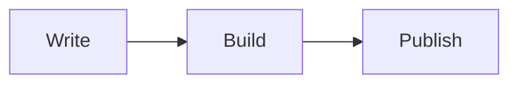

Use this page to look up a layout, snippet or page setting. For everyday editing,
use [Create a post](./15-create-post), [Create a page](./16-create-page) or
[Add an image](./17-add-image). A **layout** is a page design; **front matter** is
the settings block between `---` lines at the top of a content file.

Moving existing posts or pages? Use the
[migration front matter mapping](./46-migration-fields#layouts-and-page-front-matter).

## Choose a layout or an optional feature

The `default` layout works for ordinary articles and pages. Use
[Minimal](#minimal) for a simpler page or [Landing page](#landing-page) for a
prominent introduction. The reference below covers page options, indexes,
galleries and custom layouts; you do not need to configure them all.

Features marked **v2.2.0** require that version or later; they are absent from
v2.1.0. An unpinned remote theme follows `main`; a pinned release or installed
gem only provides the features included in that version.

| Recent feature | How to enable it | Availability |
| --- | --- | --- |
| [Mermaid diagrams](#mermaid-diagrams) | Page front matter: `mermaid: true`, plus Mermaid code blocks | v2.2.0 |
| [PhotoSwipe galleries](#photoswipe-lightbox) | Liquid include parameter: `photoswipe=true` | v2.2.0 |
| [Active TOC section](#options) | Automatic with an in-page, sidebar or kramdown TOC and JavaScript | v2.2.0 |
| [GoatCounter analytics](./02-config#goatcounter-analytics) | Site setting: `goatcounter`, plus a production build | v2.2.0 |

## A. Layouts

### General purpose

#### Default

`default` is the article and ordinary-page layout. Front matter specimen:

```yaml
---
layout: default
---
```

Site-wide default-layout mapping specimen in `_config.yml` (explicit page values
take precedence):

```yaml

defaults:
  -
    scope:
      path: ""
    values:
      layout: "default"

```

##### Options

Additional options you can set on the front matter or via defaults:

Jekyll also accepts these settings in the same front matter block:

| Setting | Use |
| --- | --- |
| `layout` | Choose a layout from this guide. |
| `permalink` | Set a page's address, such as `/contact/`. |
| `published` | Set `false` to omit a page or post from the normal build; this does not protect private files. |
| `slug` | Set the slug used by a post's address pattern. |
| `categories`, `tags` | Group articles and provide the labels used by badges and related cards. |
| `excerpt_separator` | Override the site's post excerpt boundary. |
| `sitemap` | Set `false` to exclude the page from `jekyll-sitemap`. |
| `locale` | Override the site language for this page. |

Component switches such as `show_date`, `show_author`, `show_toc`,
`show_comments` and `show_breadcrumb` are off when unset, unless your site's
`defaults` enables them. `show_header` is a separate opt-in for `minimal`;
see [Optional header](#optional-header).

- `title`, `subtitle`: Visible heading and subtitle for supported header types;
  also used when generating metadata.
- `date`, `last_modified_at`: Date of the page and last modification date. See [here](https://jekyllrb.com/docs/variables/#page-variables) to learn the accepted format of dates.
- `excerpt`: Brief description of the content. If not provided <span class="chulapa">Chulapa</span> would create it as the first paragraph of the content. Note that in the case of documents under `posts` Jekyll allows [additional options](https://jekyllrb.com/docs/posts/#post-excerpts).
- `description`: Explicit metadata description, independent of the visible subtitle and excerpt. See [SEO metadata](#seo-metadata) for precedence.
- `mathjax`: Set to `true` to load MathJax for mathematical notation.
- `mermaid`: Set to `true` to render Mermaid diagrams. Disabled by default; see
  [Mermaid diagrams](#mermaid-diagrams).
- `og_image`: Open Graph image displayed on the web and social networks when
  sharing the page. This image would not be displayed on the page.
- `schema_image`: A representative image URL or list of image URLs for a post's
  `BlogPosting` JSON-LD. It overrides the article image without changing Open
  Graph, Twitter cards or the visible header. See [Article
  images](#article-images).
- `robots`: Search engine instructions, such as `"noindex, follow"`. This does
  not make a page private; see [Search crawler directives](#search-crawler-directives).

- `header_type`: Choose `base`, `post`, `hero`, `image` or `splash`. Leave it
  unset or use an unrecognized value for no header.
- `header_img`: Image to be displayed on the header. If `og_image` is not set,
  this would be also the image to be displayed when sharing the page.

**Image previews** depend on each social platform's requirements. Use an
accessible image URL and check the resulting preview. You can use a
high-resolution image for `header_img` and a smaller sharing image for
`og_image`.
{: .alert .alert-info .p-3 .mx-2 .mb-3}

- `project_links`: Add header navigation links styled as buttons, for example
  links to a project's source code or documentation. Each entry accepts `url`,
  `icon` and `label`. Example:

```yaml
---
title: External project
project_links:
    - url: https://github.com/XXX # url1
      icon: fab fa-github         # Font Awesome icon code1
      label: View on GitHub       # Label on button 1
    - url: https://colab.research.google.com/XXX #url2
      icon: fab fa-python   # Font Awesome icon code2
      label: Open in Colab  # Label on button 2
---
```
- `show_date`: Display the publication date and the last modified date,
  if provided.
- `show_sociallinks`: Display sharing links for Facebook, Twitter/X, WhatsApp
  and LinkedIn.
- `show_author`: Set it to `true` to display the author of the page. By default it would display the `author` set on your [global settings](https://dieghernan.github.io/chulapa/docs/02-config), but you can override it via the page front matter:

  For a guest author, set their own profile URL; it does not inherit the site
  author's URL.

```yaml
---
title: "Plain post 2"
subtitle: "Example 2"
author:
  name: Another name
  url: /about/another-author/
  location: Santiago de Compostela
  avatar: https://github.com/devdieghernan.png
  links:
    - url: https://twitter.com/jack2
      icon: "fab fa-twitter"
      label: "Twitter"
---
```

- `show_toc`: Would display a table of contents of the page (thanks to [@allejo](https://github.com/allejo/jekyll-toc)). Headings with the `no_toc` class are excluded, as they are from kramdown content indexes.

- `show_sidetoc`: Alternative implementation of `show_toc` where the table of
  contents is displayed in a sliding off-canvas sidebar. This adds a
  button <button class="btn btn-primary btn-sm rounded-right bs-canvas-anim
  chulapa-btn-nofocus chulapa-fa-static" aria-label="Example button"
  style="opacity:0.4;border-top-left-radius: 0;
  border-bottom-left-radius: 0;">
		<i class="fa-solid fa-plus"></i><span class="sr-only">Example button</span>
	</button> on the left side of your page, click it to expand the sidebar table of contents. See the implementation on the [Current skin](https://dieghernan.github.io/chulapa/skins/current).

In v2.2.0, the in-page TOC, sidebar TOC and
kramdown's `{:toc}` highlight the current section as you scroll, with
`aria-current="location"` on its link. Each TOC tracks only its included, rendered headings; headings inside closed or
hidden containers are skipped until shown.
The indicator follows the last heading that has passed the reading line near
the top of the viewport; reaching the bottom selects the last section.
This requires JavaScript; anchor links still work without it. It does not move
keyboard focus or change the sidebar's Tab order, and needs no extra YAML setting.

**Table of contents requires heading IDs.** Only headings with an `id` are displayed. If you are
including headers via markdown (`### Title`) you don't have to worry, as
**kramdown** would do it for you. However if you are using `html` (`<h1
id="aa">My heading</h1>`) don't forget to include the `id`.
{: .alert .alert-info .p-3 .mx-2 .mb-3}

- `h_min` and `h_max`: Minimum and maximum heading level to be included in the
  table of contents. **min: 2, max: 4**.

- `show_related`: Display up to three related collection documents, excluding
  the current page. Candidates must share at least two tags if they are in the
  same collection or at least three tags otherwise. More matches rank first,
  with newer dates used within each score.

In v2.2.0, a candidate with `show_date: false` has no date footer in
related or random cards. Other candidates retain the existing date display.

- `show_random`: Display up to three randomly selected documents from the same
  candidate pool as `show_related`. Selection happens at build time, so the
  cards do not change on every page load. In v2.2.0, a
  pool with one eligible document renders that document instead of empty cards.

**Related and random cards require tags.** Both components use collection
documents and the tag-based candidate pool; they do not select arbitrary pages.
{: .alert .alert-info .p-3 .mx-2 .mb-3}

- `related_label` and `random_label`: Text or HTML displayed before the related
  and random cards, respectively. Custom HTML is rendered as supplied. Use
  headings that fit the page hierarchy, such as `<h2 class="h5">Related
  posts</h2>` for a separate section. The `h5` class controls its visual size
  without skipping heading levels.

- `show_bottomnavs`: Display previous and next navigation at the bottom of the
  page when Jekyll supplies `page.previous` and `page.next`. This does not
  create navigation between arbitrary standalone pages.

- `show_categories` and `show_tags` would display badges at the bottom with the
  `categories` and `tags` set for the page. These badges could be set as links
  to a cloud tag page, with the landing page url defined on `cloudtag_url` and
  `cloudcategory_url`. See [Cloud tags](#cloud-tags-and-categories) layouts.
- `include_on_search`: Set to `false` to exclude a page from the Lunr, Fuse.js and Simple-Jekyll-Search indexes. Pages are included unless this value is explicitly `false`. For Algolia, this setting affects ranking only when configured in `customRanking`; it does not exclude records. Use [Algolia's `files_to_exclude`](https://github.com/algolia/jekyll-algolia/blob/main/docs-src/src/options.md#files_to_exclude) to exclude files. This option does not control external search crawlers; use `robots` for crawler directives.

- `include_on_feed`: Set the YAML boolean `true` to include a post or collection
  document in the theme's Atom and RSS feeds, provided it has a resolved date.
  This field does not include ordinary standalone pages.

Feeds are available at `/atom.xml` (Atom) and `/rss.xml` (RSS 2.0), under the
site's `baseurl`. Selection is limited to posts and collection documents whose
`include_on_feed` is boolean `true` and whose resolved `date` is non-null.
Collection output must be enabled (`output: true`) for linked articles to be
published; feed inclusion does not enable it. An ordinary standalone page is
not selected. Jekyll 4 can infer dates for
collection documents; set dates explicitly for consistent ordering across
supported Jekyll versions.

For setup, use [Publish posts in the built-in feeds](./56-publish-feeds).
For an existing plugin address, use [Keep a jekyll-feed subscription address](./57-jekyll-feed).

- `show_comments`: Display the comment widget when a supported
  `comments.provider` is configured.
- `show_breadcrumb`: Shows breadcrumb navigation on a page. Use with
  `breadcrumb_list`.
- `breadcrumb_list`: A list with breadcrumbs. It is a good practice to set this
  on your defaults.

```yaml
---
title: "Plain post 3"
show_breadcrumb: true
breadcrumb_list:
  - label: Home
    url: /
  - label: Demo
    url: /demo
---
```

See an example [here](https://dieghernan.github.io/chulapa/demo/archive).

Even if you don't want to show the breadcrumb, you can still specify the paths. The theme generates breadcrumb JSON-LD independently of `show_breadcrumb`. Without a list, non-home pages use a home/current-page breadcrumb. Structured data does not guarantee rich results. More information [here](https://developers.google.com/search/docs/appearance/structured-data/breadcrumb) and test tool [here](https://search.google.com/test/rich-results).
{: .alert .alert-info .p-3 .mx-2 .mb-3}

### Landing page

This is a version of the `default` layout that uses a dedicated background and
text color. The background defaults to `hero-chulapa-bg-color`, which defaults
to the navbar background color. Set `landingpage-chulapa-bg-color` and
`landingpage-chulapa-text-color` through `chulapa-skin.vars` to customize it.
```yaml
---
layout: landingpage
---
```

The options are the same as those for the [`default`](#default) layout.

#### Minimal

The `minimal` layout includes the navbar, footer and an optional header.
Shared metadata options such as `description`, `seo_title`, `og_title`,
`canonical_url` and `locale` remain available, along with:
`title`, `subtitle`, `date`, `last_modified_at`, `excerpt`, `mathjax`, `mermaid`,
`og_image`,
`schema_image` (for posts), `robots`, `author`, `include_on_search`,
`include_on_feed` and `show_comments`. Content is rendered directly between
the navbar and footer; author panels and tables of contents are not
added automatically.

Unlike `default` and `landingpage`, `minimal` does not automatically declare a
Microformats2 `h-entry`. Custom content can provide its own `h-entry` wrapper,
with `p-name`, `u-url` and `e-content` properties, without including the navbar
or footer in the entry. This behavior is available in v2.2.0.
{: .alert .alert-info .p-3 .mx-2 .mb-3}

```yaml
---
layout: minimal
---
```

##### Optional header

Minimal pages remain headerless by default, even when `header_type` is set through global defaults. To reuse a theme header while keeping the content area unrestricted, set the Boolean `show_header: true`:

```yaml
---
layout: minimal
title: My wide page
subtitle: Custom content with a theme header
show_header: true
header_type: hero
header_img: /assets/img/banner.jpg
---
```

Use the existing header types (`base`, `post`, `hero`, `image` or `splash`) and `project_links` options. A missing or unsupported `header_type`, including `none`, produces no header. Set `show_header: false` to disable the optional header on a minimal page, including when overriding front matter defaults. The option does not add a content container; your HTML controls the width and spacing. See the [minimal header demo]({{ '/demo/minimal-header' | absolute_url }}).

`show_header` controls the optional header in `minimal` and custom layouts that inherit from it. The existing headers in `default` and `landingpage` retain their behavior and render only once. To hide those headers, keep using `header_type: none`.

If a custom layout already includes its own header, add `header_in_content: true` to that layout's front matter before enabling `show_header`. This prevents the parent `minimal` layout from adding another header. Custom layouts without an existing header can use `show_header: true` directly.

### Specific purpose

All these layouts are meant to be used for specific purposes rather than for
overall content. These layouts are linked to the `default` layout, so all the
options described above also apply.

#### Archive

This layout creates a chronological archive of your content. See an example [here](https://dieghernan.github.io/chulapa/demo/archive). Currently you can include any collection (including `_posts`) or select some. This allows you to have specific archives by collection and an overall archive for all your content.

Options available:
- `include_collection`: Collection name or comma-separated collection names,
  such as `posts,demo`. Use names without leading underscores and omit spaces
  around commas. If unset, **documents from all collections are included**.
  Standalone pages are not included.
- `include_missdates`: Set it to `true` if you want to include also those pages
  without a date.

```yaml
---
layout: archive
---
```

#### Cloud tags and categories

There are two layouts you can use to create clouds of tags and categories:

```yaml
---
layout: cloudtag
---

OR

---
layout: cloudcategory
---
```

Setup: [Add tag and category indexes](./63-tag-category-clouds). The index
page selects collections; `cloudtag_url` and `cloudcategory_url` on documents
or their defaults connect the article badges to that page. `show_tags` and
`show_categories` control badge display. A matching permalink is required.

Use `cloudtag` and `cloudcategory` with Jekyll 3 or 4. The old `cloudtag2` and
`cloudcategory2` layouts are compatibility aliases; no `grouptag.rb` plugin is
required.

`include_collection` is optional; see the [Archive](#archive) layout.

In v2.2.0, cloud entries respect each document's
`show_date: false`: the publication date, calendar icon and date separator are
hidden, while reading time remains. This also applies to the compatibility
aliases and prevents undated guides from displaying Jekyll's fallback build date.
It does not change which documents appear or their ordering.

See a working example of the cloud tag on a list of collections [here]({{"./demo/tags" | absolute_url }}).

#### Index category

This layout creates an index of pages of a specific collection with a [card layout](https://getbootstrap.com/docs/4.5/components/card/):

```yaml
---
layout: indexcategory
---
```

Optional arguments:
- `include_collection`: see [Archive](#archive) layout.
- `index_sort`: Front matter field used for sorting, such as `title`, `date`
  or a custom field. Defaults to `name` (the file name).
- `index_sort_asc`: Set it to `true` if you want to have the cards sorted in
  ascending order. The default order is descending.
- `index_items`: Limit the number of items to be displayed. **10**.

Filename-order mapping specimen (sorting is by document field, not title):

```yaml
---
layout: indexcategory
include_collection: demo
index_sort: name
index_sort_asc: true
index_items: 100
---
```

Sorting uses the selected field rather than the displayed title; the item limit
is applied after sorting. Galleries use `basename` for filename order because
they contain static files rather than collection documents.

The [live card index](../demo) uses `index_sort: path` with ascending order;
its source/output example demonstrates the resulting numbered demo order.

For a paginated post index, use [`jekyll-paginate`](https://jekyllrb.com/docs/pagination/#enable-pagination). The [chulapa-101 home page](https://dieghernan.github.io/chulapa-101/) uses this plugin; its [index.html](https://github.com/dieghernan/chulapa-101/blob/main/index.html) lists five posts per page with previous and next links. Keep the filename `index.html` and configure `paginate` and `paginate_path` in `_config.yml`. For a separate blog index, use [the documentation site's example](https://github.com/dieghernan/chulapa/blob/main/docs/blog/index.html).
{: .alert .alert-info .p-3 .mx-2 .mb-3}

#### Search layout

Use `layout: search` for a dedicated search page. It selects the search widget
from `search.provider` and renders its own title, navbar and footer. It does
not inherit the optional components of `default`.

The page's `permalink` matches `search.landing_page` in `_config.yml`
(default `/search`). Search menu links use this path; the classic navbar and
the desktop form of `dual` also require `navbar.nav` to show the link. Configuring
a provider does not create the page. Setup is covered by the
[provider guides](./02-config#search-engines).
{: .alert .alert-info .p-3 .mx-2 .mb-3}

### A note on defaults

Defaults mapping specimen for shared post settings in `_config.yml`:

```yaml
defaults:
  - scope:
      path: ""
      type: posts
    values:
      layout: default
      header_type: post
      show_date: true
```

A setting in an individual post overrides its default. Use `true` and `false`
without quotes for switches such as `show_date`. See
[Jekyll's defaults guide](https://jekyllrb.com/docs/configuration/front-matter-defaults/)
for other content types.

## B. Snippets

Look up content snippet parameters here. For setup, use the
[gallery](./29-add-gallery), [carousel](./30-add-carousel),
[PhotoSwipe](./31-photoswipe), [video](./32-embed-video) or
[Mermaid](./33-add-diagram) How-To Guide.

These are the content snippets and their parameters.
Parameters belong in the include call, not in page YAML:

| Snippet | Parameters and defaults |
| --- | --- |
| `snippets/masonry.html` | `internal`: image group named by `image_col`; or `external`: comma-separated image addresses. `index_sort`: `modified_time` for internal images; `index_sort_asc`: `false`; `index_items`: `100`; `random`: `false`; `photoswipe`: `false`. Internal images take precedence if both sources are supplied. |
| `snippets/carousel.html` | All masonry parameters, plus `interval`: `5000` milliseconds (`0` stops automatic cycling), `controls`: `false`, and `indicators`: `false`. |
| `snippets/video.html` | Use `fileurl` for a video file, or `provider` and `id` for a supported service. `name` identifies the player. YouTube accepts `nolazy` (off by default) and `video_res` (`maxresdefault`). Optional metadata: `thumbnail_url`, `upload_date`, `description`, `duration`. `fileurl` takes precedence over a provider. |
| `snippets/youtube.html` | A direct deferred YouTube player: required `id`; optional `name`, `video_res` (`maxresdefault`), `thumbnail_url`, `upload_date`, `description`, `duration`. To disable deferred loading, use `video.html` with `provider="youtube" nolazy=true`. |
| `snippets/datetranslate.html` | Required `date`: an English formatted date string. Optional `lang`: language code; defaults to site `locale`, then English. Supported translations: Spanish, French, German and Italian; other languages retain English names. |
| `snippets/bootstrapdemo.html` | No parameters. Displays the full component sampler used by the skin previews; ordinary articles do not need it. |

**Use unquoted booleans in snippets.** Write `controls=true` or `random=false`.
Quoted `"false"` can enable a feature; PhotoSwipe specifically requires
`photoswipe=true`. These are include parameters, not new configuration options.
{: .alert .alert-warning .p-3 .mx-2 .mb-3}

### Masonry gallery

Setup: [Add a photo gallery](./29-add-gallery).

| Parameter | Default | Values and constraints |
| --- | --- | --- |
| `internal` | Unset | Group name assigned to static files through `image_col` in configuration defaults. Takes precedence over `external`. |
| `external` | Unset | Comma-separated image URLs, optionally held in a Liquid variable. |
| `index_sort` | `modified_time` | Internal galleries only; a static-file property such as `basename`. Static files have a [limited set of properties](https://jekyllrb.com/docs/static-files/). |
| `index_sort_asc` | `false` | Internal galleries only; boolean `true` for ascending order. |
| `index_items` | `100` | Maximum images displayed. |
| `random` | `false` | Boolean `true` shuffles at build time, overriding the sort order. |
| `photoswipe` | `false` | Boolean `true` enables the optional viewer; see [PhotoSwipe](#photoswipe-lightbox). |

**Version constraint:** applying the selected `index_sort` field to internal
galleries and carousels is fixed in v2.2.0. It does not work
correctly in v2.1.0; the filename-order guides require the fix.
{: .alert .alert-info .p-3 .mx-2 .mb-3}

External-source specimen:


```liquid


```





Internal-source specimen, for a configured `gallery` image group:


```liquid

```




### Bootstrap carousel

Setup: [Add a manual slideshow](./30-add-carousel). All [masonry parameters](#masonry-gallery)
also apply. Additional parameters:

| Parameter | Default | Values and constraints |
| --- | --- | --- |
| `interval` | `5000` | Milliseconds between automatic slide changes. `0` disables automatic cycling. |
| `indicators` | `false` | Boolean `true` displays slide indicators. |
| `controls` | `false` | Boolean `true` displays previous/next controls. |

In v2.2.0, a multi-image slideshow has a play/pause icon button with an
action-specific accessible name and a symbol fallback if Font Awesome is missing.
Reduced-motion visitors start paused. Keyboard control use pauses cycling;
Enter and Space activate controls. Hovering pauses temporarily. Custom layouts
must load Bootstrap's scripts for controls and automatic cycling.

Control colors are Sass variables under the existing `chulapa-skin.vars` mapping
in `_config.yml`: `carousel-control-color` and `carousel-indicator-active-bg`.
See [Change a color](./23-change-color) for editing steps.

Automatic-cycling specimen, for a configured `gallery` group:


```liquid

```




### PhotoSwipe lightbox

Setup: [Enable PhotoSwipe on a gallery](./31-photoswipe).

Available in v2.2.0, not in v2.1.0. `photoswipe` is a boolean include parameter
on masonry and carousel snippets, **not** a page YAML setting. Default: `false`;
only `photoswipe=true` enables it. It accepts internal image groups and external
image lists; each gallery opens its own sequence.


```liquid


```


The viewer loads on image activation from `https://cdn.jsdelivr.net`; a Content
Security Policy must allow its scripts and styles. It supports zoom, swipes,
arrow keys and Escape, returns focus to the image and respects reduced motion.
If loading fails, the link opens the original image. Gallery snippets use generic
image descriptions; custom image markup needs descriptive alternative text.

Live specimen: [PhotoSwipe demo](../demo/14-photoswipe).

### Video support

Setup: [Embed a video](./32-embed-video).

| Input | Default | Values and constraints |
| --- | --- | --- |
| `fileurl` | Unset | Local or external video-file URL. Takes precedence over `provider`. Local paths use the site URL and `baseurl`. |
| `provider` | Unset | `youtube`, `vimeo`, `dailymotion`, `google-drive` or `bilibili`; used with `id`. |
| `id` | Unset | Provider-specific identifier, not a full watch URL. |
| `name` | Generic player name if absent | Actual video title; also supplies metadata and the player's accessible name. |
| `nolazy` | Off | YouTube only; boolean `true` creates an iframe without activation. The browser may still defer the iframe through `loading="lazy"`. |
| `video_res` | `maxresdefault` | Deferred YouTube preview resolution; see [preview behavior](#deferred-lazy-loading-of-youtube-videos). |

The accessible player and play-button names derived from `name` require v2.2.0; v2.1.0 supports `name` in video metadata but does not
use it for those accessible names.

For `fileurl`, browser-supported formats include MP4, Ogg and WebM. Playback
also depends on the codec and browser; the extension alone is insufficient.

YouTube specimen:


```liquid

```




Local-file specimen:


```liquid

```




External-file specimen:


```liquid

```




#### Deferred (lazy) loading of YouTube videos

Default: a preview loads first; activation loads the player. In v2.2.0, a link opens YouTube when JavaScript is disabled; v2.1.0
does not provide that fallback link. Autoplay remains subject to browser policy.
The iframe uses `https://www.youtube-nocookie.com`, which must be allowed by a restrictive
Content Security Policy.

`nolazy=true` on `video.html` removes the activation requirement. Direct
`youtube.html` calls are always deferred and have no `nolazy` parameter.


```liquid

```




`video_res` defaults to `maxresdefault`; some videos lack that preview. A value
such as `hqdefault` selects a different [YouTube preview variant](https://stackoverflow.com/a/2068371/7877917).
This changes the displayed preview, unlike `thumbnail_url` (metadata only).


```liquid

```




#### Optional video metadata

Both `snippets/video.html` and `snippets/youtube.html` accept these optional
inputs for the embedded video's microdata:

| Input | What to supply |
| --- | --- |
| `name` | The video's actual title. |
| `thumbnail_url` | A representative, accessible image URL. Relative URLs use the site's URL and `baseurl`. |
| `upload_date` | The video's original publication date in ISO 8601 format, preferably with time and time zone. |
| `description` | A description of the video. |
| `duration` | An ISO 8601 duration, such as `PT1M30S` for 90 seconds. |

Pass metadata per include, so several videos on the same page can have different
values. Missing, empty or whitespace-only inputs are omitted. Dates and durations
are emitted as supplied; the snippets do not validate or infer them from the
containing page. Existing calls continue to work.

These illustrative examples use placeholder metadata. Replace every value with
accurate information about your video before publishing:


```liquid



```


The same inputs work with the other supported providers and with deferred
YouTube embeds. Metadata stays outside the deferred player, so it is available
before a click and remains after playback starts. `thumbnail_url` supplies
structured data only; it does not change the player, its preview or its poster.

#### Video structured data limitations

Video descriptions can help search engines understand your content, but do
not guarantee indexing. Supply an accurate `name`, `thumbnail_url` and
`upload_date`; the theme does not fetch them from the video provider.
Check that your thumbnail image exists.

For a page dedicated to watching a video, consider `nolazy=true` so the player
loads without a click. See [Google's video requirements](https://developers.google.com/search/docs/appearance/structured-data/video)
for the remaining conditions.

### Localization of dates

Reference for `snippets/datetranslate.html`. For editing and publishing, use
[Display an article date in another language](./61-localize-date).

| Parameter | Value and behavior |
| --- | --- |
| `date` | An English date string, usually formatted with Liquid's `date` filter before passing it to the snippet. |
| `lang` | Optional language code. Defaults to site `locale`, then `en`; a page-level locale is not read automatically. Only the first two lowercase characters are used. |

Supported translations are French (`fr`), Spanish (`es`), German (`de`) and
Italian (`it`). English is the default/fallback. The input is lowercased before
month/weekday replacements; unsupported languages keep lowercase English names.
Order and punctuation come from the input format, not a locale-specific pattern.
Format specifiers: [Liquid date filter](https://shopify.github.io/liquid/filters/date/).

Site `locale` controls language metadata, not complete interface translation.
Labels such as `search.label`, `related_label` and `random_label` are separately
configurable; some interface and accessibility labels remain in English.

The source/output specimens below include explicit languages and the site-locale
fallback. Their fixed date makes the translation differences comparable.


```
{%- assign formatdate = "2020-02-14" | date: "%A %d, %B %Y" %}

- Raw date output is {{ formatdate }}

- Without parameter: 

- In Spanish: 

- In German: 

- In French: 

- In Italian: 

- Any other value in English: 

```


{%- assign formatdate = "2020-02-14" | date: "%A %d, %B %Y" %}

- Raw date output is {{ formatdate }}

- Without parameter: 

- In Spanish: 

- In German: 

- In French: 

- In Italian: 

- Any other value in English: 

### Mermaid diagrams

Setup: [Add a Mermaid diagram](./33-add-diagram).
Live specimens: [Mermaid demo](../demo/13-mermaid).

Available in v2.2.0, not in v2.1.0. Use the updated default
branch or a later release containing this feature; the v2.1.0 gem does not
include it.

`mermaid` is a boolean page/front matter default, disabled when unset.
`true` enables fenced `mermaid` blocks. Complete page specimen:

````markdown
---
layout: default
title: A diagram
mermaid: true
---


````


The option works with layouts based on `minimal`, including `default` and
`landingpage`. The `search` layout does not display page content. Mermaid 12.1.0 loads from jsDelivr only on
enabled pages containing diagrams. It requires a modern browser supporting
JavaScript modules and ES2024 (Safari 17.4 or later). No additional Jekyll plugin
is required. Diagrams use Mermaid's strict security mode, which disables
click actions and encodes HTML labels. Add `accTitle` and `accDescr` to describe
diagrams for assistive technology, and provide a prose explanation for complex
content. Wide diagrams can scroll horizontally. If JavaScript, the CDN or a
diagram fails, its source remains visible. Without `mermaid: true`, fenced
blocks remain ordinary code. Native `<pre class="mermaid">` blocks are also
supported. See the [Mermaid documentation](https://mermaid.js.org/config/usage.html).

### Copying code

Code blocks have a copy button. Use HTTPS on your published website so the
browser can copy text. If copying fails or permission is denied, visitors can
still select and copy the code themselves. In v2.2.0, the button confirms
success or reports failure. Rendered Mermaid diagrams have no code copy button.

## Advanced page settings

These settings change how search engines and sharing services describe a page.
They are optional: start with accurate titles, descriptions and photographs.
Use the reference below if you need different sharing titles, translated
metadata or instructions for republished content.

### SEO metadata

The theme creates sharing and search metadata automatically from each page's
address. Ordinary pages do not need a custom canonical URL.

`canonical_url` identifies the original version in page metadata. Accepted
values are absolute HTTP(S) URLs or site-relative paths starting with `/`.
Procedure: [Point a republished article to its original URL](./62-canonical-article). Site-relative values use `url` and `baseurl`. Blank values, unsupported
schemes and protocol-relative URLs fall back to the page's own URL. Fragments
are removed. The page path still controls its home-page classification.

```yaml
canonical_url: https://example.com/original-article/
sitemap: false
```

This identifies the original article to search engines and sharing services.
It does not redirect visitors or change your page's address.
`jekyll-sitemap` uses the actual page URL, independently of this override;
`sitemap: false` excludes the duplicate. The original remains in its own sitemap.
Paginated pages retain individual canonicals, not a shared page-one URL. See
[Google's canonical guidance](https://developers.google.com/search/docs/crawling-indexing/consolidate-duplicate-urls).

Use `seo_title` to replace the complete browser and structured-data title without
changing the visible heading. Use `og_title` to replace the social
title; it defaults to the generated browser title. Leave these settings empty to use the normal titles.

Optional `og_image_alt`, `og_image_width`, `og_image_height` and `og_image_type`
fields describe the selected social image. Width and height are pixels; type is
a MIME type such as `image/jpeg`. Alt text describes the image's contents.

```yaml
seo_title: A custom browser title
og_title: A custom social title
og_image: /assets/img/article.jpg
og_image_alt: A street in Madrid
og_image_width: 1200
og_image_height: 630
og_image_type: image/jpeg
```

The image fallback order remains page `og_image`, page `header_img`, site
`og_image`, site author avatar, then GitHub avatar. If no image is available,
image and thumbnail tags are omitted. Page image metadata applies to the
selected image. Site image metadata is used only when the site `og_image` is
selected and neither page image field is set; it is never inherited by a page
image or avatar. Supply accurate metadata for the selected image; the theme
does not inspect image files. These options also support front matter defaults.
See the [Open Graph protocol](https://ogp.me/) for image properties.

### Social locales and articles

Set page `locale` to override the HTML language in both the minimal and search
layouts. Other built-in layouts inherit the minimal layout. Use a language tag
such as `fr`, `es-MX` or `zh-Hant`. Underscores are converted to hyphens for HTML.

Open Graph uses `language_TERRITORY`. The precedence is page `og_locale`, page
`locale`, site `og_locale`, then site `locale` (default `en-US`). Hyphens are
accepted and values are normalized, for example `es-mx` becomes `es_MX`.
Language-only or script-based values do not identify a territory, so the theme
omits `og:locale` for them. Supply `og_locale` explicitly when needed:

```yaml
locale: zh-Hant
og_locale: zh_TW
og_locale_alternate:
  - en_GB
  - es_ES
```

`og_locale_alternate` is an optional list on the page or site. A page list
replaces the site list; `[]` disables inherited alternates. Entries must contain
a two- or three-letter language and a two-letter territory. Invalid shapes,
duplicates and the primary locale are omitted. Codes are not checked against an
ISO registry. Only list locales in which the page is actually available; these
tags do not create translations or `hreflang` links.

Posts use `og:type: article`; other pages use `website`. Set `og_type: article`
for an article in another collection, or `og_type: website` to suppress article
metadata on a post. This changes Open Graph only; JSON-LD retains its existing
page classification.

For `article`, the theme emits these properties when values are available:

| Property | Source |
| --- | --- |
| `article:published_time` | Page `date`, including the date in a post filename. |
| `article:modified_time` | Page `last_modified_at`; no modification date is invented. |
| `article:author` | `og_article_author`, then page `author.url`, or site `author.url` when no page author is set. |
| `article:section` | `og_article_section`, then the first page category. |
| `article:tag` | One tag per nonempty entry in page `tags`. |

Dates use Jekyll's ISO 8601 output. Author URLs may be absolute or site-relative;
relative paths use `url` and `baseurl`. A guest author without a profile URL does
not inherit the site author's URL. Use a profile page that identifies the author.

```yaml
og_type: article
og_article_author: /about/guest/
og_article_section: Mapping
date: 2024-02-03T12:00:00Z
last_modified_at: 2024-03-04T13:00:00Z
tags:
  - maps
  - open data
```

The generated tags precede custom head hooks. Configure these fields instead of
adding duplicate properties in a hook. See the [Open Graph protocol](https://ogp.me/).

`description` is optional page metadata independent of visible content.
Procedure: [Set a post's sharing text and images](./64-post-sharing). Specimen:

```yaml
---
title: My page
subtitle: A visible subtitle
description: A concise description for search and social previews.
---
```

Description precedence is:

1. A nonempty page `description`, used without a subtitle prefix.
2. The page `excerpt`.
3. On the home page only, the site's `description`.
4. The existing content fallback.

Whitespace-only values are treated as missing. For the excerpt or fallback path,
the subtitle is prepended only if it is nonempty and its text is not already
contained in the description, ignoring case. An empty description uses the
subtitle alone, without an empty separator. Markdown and HTML are reduced to
text, whitespace is normalized and values are escaped for metadata output.
Front matter defaults can also supply `description`.

HTML, Open Graph, Twitter/X and JSON-LD share this description. The complete
generated text is retained, replacing the previous 160-character HTML limit and
20-word Open Graph limit. Keep descriptions concise and descriptive. Google may
choose another snippet and truncate it to fit the device; there is no fixed meta
description length limit. See
[Google's snippet documentation](https://developers.google.com/search/docs/appearance/snippet).

Search indexing settings are independent:

| Setting | Effect |
| --- | --- |
| `robots: "noindex, follow"` | Asks external crawlers not to index the page. It does not remove sitemap entries. |
| `sitemap: false` | Excludes the page from `jekyll-sitemap`. It does not prevent indexing by itself. |
| `include_on_search: false` | Excludes the page from the supported internal search indexes. It does not control external indexing; Algolia exclusions are configured separately. |

Combined auxiliary-page mapping specimen (setup and verification are in the
[search visibility guide](./65-search-visibility)):

```yaml
robots: "noindex, follow"
sitemap: false
include_on_search: false
```

The documentation's [search page]({{ '/search.html' | relative_url }}) uses these
settings; its [source](https://github.com/dieghernan/chulapa/blob/main/docs/_pages/search.md)
is a complete example. There are no automatic exclusions by path or layout.

### Article images

`schema_image` identifies post illustrations for `BlogPosting` structured data.
A single URL or YAML list is accepted. Procedure: [Set a post's sharing text and images](./64-post-sharing). Relative URLs resolve
using the site's `url` and `baseurl`; absolute URLs remain unchanged.

```yaml
---
title: My article
schema_image: /assets/img/article.jpg
---
```

Multi-image mapping specimen (each URL identifies an existing article image):

```yaml
schema_image:
  - /assets/img/article-16x9.jpg
  - /assets/img/article-4x3.jpg
  - /assets/img/article-1x1.jpg
```

The theme emits the URLs as a JSON-LD `image` array. It does not create crops, check image dimensions or verify that the files exist. Google recommends relevant, crawlable images and multiple high-resolution aspect ratios when available; see the [article structured data guidelines](https://developers.google.com/search/docs/appearance/structured-data/article).

The fallback order is `schema_image`, page `og_image`, then page `header_img`.
Missing values, empty strings and empty lists use the next fallback.
Whitespace-only URLs and blank entries in lists are omitted after selection; a
whitespace-only value or a nonempty list containing only blanks therefore omits
`image` rather than trying the next fallback. If no article image is available,
`image` is omitted from `BlogPosting`; the site banner, publisher logo and
author avatar are not used as article illustrations. Open Graph and Twitter
cards retain their existing site-level image fallbacks.

This option applies to posts rendered as `BlogPosting`, including values supplied through front matter defaults. Other pages keep their existing image metadata. The [Welcome post]({{ '/blog/20200515_welcome' | absolute_url }}) demonstrates an explicit `schema_image` using its existing header photograph.

## Search crawler directives

`robots` supplies optional page-specific crawler instructions; ordinary pages
use `index, follow`. Procedure: [Keep an auxiliary page out of search](./65-search-visibility).

`robots` applies to pages, posts and collection documents.
The default is `index, follow`; missing or empty values use this default.
Page front matter specimen:

```yaml
---
title: My page
robots: "noindex, follow"
---
```

`robots` also accepts front matter defaults in `_config.yml`:

```yaml
defaults:
  - scope:
      path: "private-pages"
    values:
      robots: "noindex, follow"
```

An explicit page value overrides these defaults. Crawlers must be able to access the page to read its robots metadata; blocking the page in `robots.txt` prevents them from reading `noindex`. This option controls only the HTML metadata and does not change HTTP status codes, `robots.txt` or sitemap entries. The theme does not automatically apply `noindex` to error pages, search pages, tags, archives or pagination. See [Google's robots metadata documentation](https://developers.google.com/search/docs/crawling-indexing/robots-meta-tag).

## Advanced customization reference

These sections are for readers creating their own layouts, embedding search
or maintaining local overrides. Standard posts and pages already receive the
theme's scripts and metadata; no changes to these files are needed for the
examples at the start of this guide.

### Layout structure and components

In v2.2.0, `default` places its page heading
and body in one `main` landmark. Its `e-content` property wraps the editorial
body, excluding the theme's optional sidebar and integrated TOCs. Lists or a
Markdown TOC written in the page body remain editorial content. Inherited
listing layouts retain `h-feed` and their child entries; the feed container does
not acquire article-content properties. Local layout overrides must be reviewed
to receive these structural changes.

For small head additions, follow [Add custom HTML to the page head](./44-custom-head).
The [custom hooks reference](./45-custom-hooks) lists the insertion points and
stylesheet hook; a complete layout copy is not required.

`minimal` supplies the base structure for a custom page design. `default` and
`landingpage` add the article components; archive, tag, category and card-index layouts build
on `default`. The `search` layout is a separate search page. Both keep the
custom head and bottom-script hooks available. See the
[layout sources](https://github.com/dieghernan/chulapa/tree/main/_layouts)
and [component sources](https://github.com/dieghernan/chulapa/tree/main/_includes/components)
when replacing a specific part.

Advanced include specimen for up to two post cards inside a custom page:


```

```


See the [card index demo](../demo) for the resulting layout.

### JavaScript assets and local overrides

The built-in layouts already load the scripts needed for menus, search and
content features. Use `_includes/custom/custom_bottomscripts.html` to add your
own scripts without copying a theme layout.

**If you have copied a layout or search page into your site, review it when
updating the theme.** Your copy takes precedence and will not receive updates
automatically. For working search-page examples, see
[Lunr](https://github.com/dieghernan/chulapa/blob/main/docs/_pages/demo_searchlunr.html)
or [Fuse.js](https://github.com/dieghernan/chulapa/blob/main/docs/_pages/demo_searchfusejs.html).

### Microformats in lists

Article lists automatically include information for other services to read.
No extra configuration is needed.

### Generated head and footer formatting

No formatting changes are needed to publish your site. The
[custom hooks reference](./45-custom-hooks) describes head and bottom-script
insertion without editing the theme's layouts.

The remaining snippets support the theme's metadata. Standard layouts already
use them; configure the corresponding page or site options instead of adding
these helpers to article content. This inventory is for custom-layout authors:

| Helper | Inputs | Purpose |
| --- | --- | --- |
| `snippets/canonical-url.html` | `url`, optional `canonical` | Prepares the canonical address; page `canonical_url` supplies the override. |
| `snippets/page-language.html` | No include parameters; page/site `locale` | Prepares the page language. |
| `snippets/og-locale.html` | `locale` | Prepares a valid social-sharing locale. |
| `snippets/publisher.html` | No include parameters; site `publisher` and author settings | Supplies publisher metadata. |
| `snippets/article-images.html` | No include parameters; page `schema_image`, `og_image`, `header_img` | Supplies article image metadata. |
| `snippets/breadcrumb-names.html` | No include parameters; site/page titles and navbar brand | Prepares breadcrumb labels. |
| `snippets/microformats-url.html` | No include parameters; page `url`, `canonical_url` | Supplies the article's canonical link for machine-readable lists. |
| `snippets/jsonld-string.html` | `value`; `decode_html` defaults to `true` | Safely outputs a metadata string; pass `false` to preserve literal HTML entities. |
| `snippets/video-metadata.html` | `name`, `thumbnail_url`, `upload_date`, `description`, `duration` | Supplies the optional video metadata described above. |

Helpers that prepare values for their caller need ordinary `include`, not
`include_cached`. For complete working usage, consult the
[theme's snippet sources](https://github.com/dieghernan/chulapa/tree/main/_includes/snippets).
