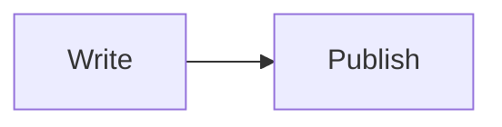

Add these examples to the body of a Markdown post or page, below the settings
block. Follow each guide for setup and version requirements.

[Alert](#alert) · [Callouts](#callouts) · [Image caption](#image-caption) · [Gallery](#gallery) ·
[Slideshow](#slideshow) · [Diagram](#diagram) · [Video](#video)

## Alert

<div role="note" class="alert alert-info p-3 mx-2 mb-3" markdown="1">
**Note:** Keep a copy of your draft before changing its permalink.

You can include a second paragraph or a list.
</div>

```markdown
<div role="note" class="alert alert-info p-3 mx-2 mb-3" markdown="1">
**Note:** Keep a copy of your draft before changing its permalink.

You can include a second paragraph or a list.
</div>
```

[Add a callout or a one-paragraph alert](./49-add-alert).

## Callouts

Callouts are available in v2.2.1 development. Use one class to select the
title, Font Awesome icon and skin color.

<div role="note" aria-label="Note" class="callout-note" markdown="1">
Keep a copy of your draft before changing its permalink.
</div>

<div role="note" aria-label="Tip" class="callout-tip" markdown="1">
Preview the post locally before publishing.
</div>

<div role="note" aria-label="Important" class="callout-important" markdown="1">
Keep internal links up to date after changing a permalink.
</div>

<div role="note" aria-label="Warning" class="callout-warning" markdown="1">
Check that your redirects work before sharing the new URL.
</div>

<div role="note" aria-label="Caution" class="callout-caution" markdown="1">
Removing a redirect can break links to the old URL.
</div>

```markdown
<div role="note" aria-label="Note" class="callout-note" markdown="1">
Keep a copy of your draft before changing its permalink.
</div>
```

[Choose a callout type and accessible label](./49-add-alert#use-a-callout).

## Image caption


Plaza de España, Madrid.
{: .caption}


```liquid


Plaza de España, Madrid.
{: .caption}
```


Replace the path, alternative text and caption with your own. [Add an image caption](./50-add-caption).

## Gallery




```liquid

```


[Set up the `gallery` image group](./29-add-gallery). This example shows its first three images.

## Slideshow




```liquid

```


Use the same image group as the gallery. [Add a manual slideshow](./30-add-carousel).

## Diagram



Add `mermaid: true` to the page settings, then paste this block into the body.

````markdown

````

[Add a Mermaid diagram](./33-add-diagram).

## Video




```liquid

```


[Find your YouTube video ID and embed the player](./32-embed-video).
