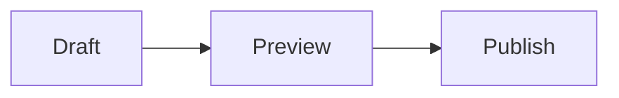

Jump to an example from the table of contents above or open the sidebar using
the button on the left edge of the page. At the end of the post, open the
BibTeX citation, follow a related demo or leave a comment. See the
[front matter on GitHub](https://github.com/dieghernan/chulapa/blob/main/docs/collections/_posts/2026-11-14-kitchen-sink.md)
for the settings used here.

## Tables of contents

Choose **Carousel** in the in-page or sidebar index, then scroll to **Video**
to see the current section update. The expandable index below is generated
by [kramdown]({{ '/docs/58-content-toc' | relative_url }}) from the same article.

<details markdown="1">
<summary>Open the kramdown table of contents</summary>

* Contents
{:toc}

</details>

## Guest author

Alex Rivera is a fictional guest author. Open the profile link in the author
card to jump back here. The [example citation](#chulapa-citation-label)
credits Alex and a fictional research group. The journal, identifiers
and links are sample data.

## Series navigation

Open **Series index** to see the full list, or select **Next** to continue to
the diagram demo. See [Series navigation](../docs/04-layouts#series-navigation)
for setup.



### Two series on one page

This post also closes the **Site identity and content** series. Compare the two
indexes above. **Component demos** offers a next chapter, while **Site identity
and content** offers a previous chapter.

## Diagrams, equations and code



The sum of the first \(n\) positive integers is:

$$
\sum_{k=1}^{n} k = \frac{n(n+1)}{2}
$$

```yaml
layout: default
show_toc: true
mermaid: true
```

## Callouts

Use callouts to give publishing advice a clear purpose. Each type supplies its
own heading and icon.

The page preview uses your current draft.
{: .callout-note role="note" aria-label="Note"}

Open the preview on a narrow screen before publishing.
{: .callout-tip role="note" aria-label="Tip"}

Update internal links before you change a published URL.
{: .callout-warning role="note" aria-label="Warning"}

Remove private tokens from the files you publish.
{: .callout-important role="note" aria-label="Important"}

Save a copy of your working configuration before switching skins.
{: .callout-caution role="note" aria-label="Caution"}

## Tabs

Switch between three stages of publishing an article. Use the arrow keys to
move between tabs.

<div class="nav nav-tabs" role="tablist" aria-label="Publishing stages" id="kitchen-publishing-tabs">
  <button class="nav-link active" id="kitchen-draft-tab" type="button" role="tab" data-toggle="tab" data-target="#kitchen-draft" aria-controls="kitchen-draft" aria-selected="true">Draft</button>
  <button class="nav-link" id="kitchen-preview-tab" type="button" role="tab" data-toggle="tab" data-target="#kitchen-preview" aria-controls="kitchen-preview" aria-selected="false" tabindex="-1">Preview</button>
  <button class="nav-link" id="kitchen-publish-tab" type="button" role="tab" data-toggle="tab" data-target="#kitchen-publish" aria-controls="kitchen-publish" aria-selected="false" tabindex="-1">Publish</button>
</div>
<div class="tab-content pt-3">
  <div class="tab-pane active" id="kitchen-draft" role="tabpanel" aria-labelledby="kitchen-draft-tab" tabindex="0">
    <p>Write your title and section headings before adding screenshots or code.</p>
  </div>
  <div class="tab-pane" id="kitchen-preview" role="tabpanel" aria-labelledby="kitchen-preview-tab" tabindex="0">
    <p>Read the generated page and try its links and controls with the keyboard.</p>
  </div>
  <div class="tab-pane" id="kitchen-publish" role="tabpanel" aria-labelledby="kitchen-publish-tab" tabindex="0">
    <p>Open the public URL after deployment and verify that it serves the latest article.</p>
  </div>
</div>
<script>
  const publishingTabs = document.getElementById('kitchen-publishing-tabs');
  const stageTabs = Array.from(publishingTabs.querySelectorAll('[role="tab"]'));

  publishingTabs.addEventListener('click', (event) => {
    if (!stageTabs.includes(event.target)) return;
    stageTabs.forEach((tab) => { tab.tabIndex = tab === event.target ? 0 : -1; });
  });

  publishingTabs.addEventListener('keydown', (event) => {
    const index = stageTabs.indexOf(event.target);
    if (index === -1) return;
    const last = stageTabs.length - 1;
    const destinations = {
      ArrowLeft: index === 0 ? last : index - 1,
      ArrowRight: index === last ? 0 : index + 1,
      Home: 0,
      End: last
    };
    if (!Object.hasOwn(destinations, event.key)) return;
    event.preventDefault();
    const tab = stageTabs[destinations[event.key]];
    tab.click();
    tab.focus();
  });
</script>

## Tables

A short table pairs each file with its purpose.

| File | Purpose |
| --- | --- |
| `_config.yml` | Site settings |
| `index.md` | Home page |

Align text to the left, status labels to the center and durations to the right
so readers can scan each column.

| Check | Status | Time |
| :--- | :---: | ---: |
| Links | Done | 2 min |
| Mobile view | Done | 5 min |
| Keyboard | Pending | 4 min |

## Blockquotes

A blockquote sets a passage apart from the surrounding prose. Add a footer
when the reader needs to know where the quotation came from.

> Preview the article at the width your readers are likely to use.

<blockquote>
  <p class="mb-0">Check the preview with a keyboard before signing off.</p>
  <footer class="blockquote-footer">Alex Rivera, <cite>Sample editorial checklist</cite></footer>
</blockquote>

## Footnotes

Keep short explanations in footnotes when they would interrupt the article.
Follow a note number to read it, then use its backlink to return.

Preview the draft locally,[^preview] check its public URL after deployment,[^canonical]
and sign off after a keyboard pass.[^keyboard]

[^preview]: A local preview shows your current files before they reach the public site.
[^canonical]: The canonical URL is the preferred public address for a page.
[^keyboard]: Test Tab and Enter on links and controls, and check that focus is visible.

## Lists

Use an ordered list when the sequence matters, and bullets when readers can
work through the items independently. A definition list pairs terms with explanations.

1. Write the draft.
2. Preview the generated page.
3. Publish after review.

- Check the article metadata.
- Review the media:
  - Check image descriptions.
  - Try the video controls.

Draft
: An article still being edited.

Preview
: A build you can inspect before publication.

## Action links

Use button styles for links that lead to a clear action. Here the main action
opens the starter guide, and the secondary links lead to supporting material.

<div class="d-flex flex-wrap">
  <a class="btn btn-primary mr-2 mb-2" href="{{ '/docs/00-start' | relative_url }}">Start a site</a>
  <a class="btn btn-secondary mr-2 mb-2" href="{{ '/demo' | relative_url }}">Browse demos</a>
  <a class="btn btn-outline-primary mb-2" href="#tables-of-contents">Back to the index</a>
</div>

## Image galleries

### Masonry gallery

Select an image to open PhotoSwipe. Use the arrow keys to browse and press
Escape to return to the gallery.



### Carousel

Use the previous and next controls to change slides, or open a slide to zoom
in with PhotoSwipe.



## Video

This aerial clip shows a lagoon from above.


