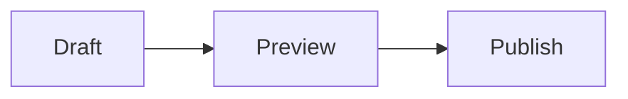

This post combines the article header, author card, sharing links and both
tables of contents. See its
[front matter on GitHub](https://github.com/dieghernan/chulapa/blob/main/docs/collections/_posts/2026-11-14-kitchen-sink.md)
for the settings used here.

## Series navigation

Open **Series index** to see the full list, or select **Next** to continue to
the diagram demo. See [Series navigation](../docs/04-layouts#series-navigation)
for setup.



## Diagrams, equations and code



The sum of the first \(n\) positive integers is:

$$
\sum_{k=1}^{n} k = \frac{n(n+1)}{2}
$$

```yaml
layout: default
show_toc: true
mermaid: true
```

## Bootstrap components



### Content components

> Use an information alert for a detail that helps readers complete a task.
{: .alert .alert-info .p-3}

<figure>
  
  <figcaption>Chulapa lettering in Madrid.</figcaption>
</figure>
